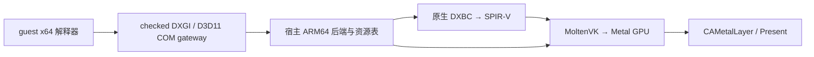

# Win64 D3D11 / DXVK / MoltenVK 接入（2026-10-08）

## 结论与当前证据

可以复用开源 D3D11 / shader 转译代码来减少自写渲染器的工作。
**当前不能通过复制 DXVK DLL + MoltenVK 就完成 wire 的游戏渲染。**
wire 既不是 Wine，也没有通用 Vulkan guest→host ABI。当前已接入原生 ARM64 图形库、
Win64 DXGI factory4 / adapter1与基础D3D11 device/context、资源的64位COM边界。
Alice的pass142已建立guest自己显示的1024×720正式窗口，执行335次真实GPU Draw与112次Present。
用户已观察到Unity logo动画；最新单帧捕获在动画之后为深色背景。当前停在GetKeyboardLayout导入，
尚未验收游戏标题画面或持续可玩。最新证据见文末windowed Draw/Present检查点。
原有pass111的Mono初始化与隐藏窗口描述属于历史推进，已越过这些边界。
接续已选择并落地 **GS→compute 展开**：11个自有GS样例、44组输入逐DWORD验证，
并完成展开结果→透传VS→真实PS→GPU光栅化的4096像素验证；已加入持久Vulkan buffer。
这补上了geometry的实现路线；guest当前用明确标注的实验性10_0兼容子集继续初始化，不宣称完整10_0符合性。

首次检查点的两个独立探针如下；后续原生库、离屏Draw和guest重放证据见下一节。
原始游戏目录保持只读。

| 实测项目 | 结果 | 证明范围 |
| --- | --- | --- |
| 官方 public-API MoltenVK 1.4.2，Apple M4 | Vulkan 1.4.357；真实 instance / device / queue / buffer / pipeline / fence | 宿主 Vulkan→Metal 可用 |
| 独立 SPIR-V compute，经 MoltenVK 转成 MSL 并执行 | 4096 个输出逐个与 CPU 期望值一致 | shader 编译、GPU 提交、同步和读回有效；没有 CPU guest JIT |
| DXVK 的独立 `dxbc-spirv`，原样 ARM64 构建 | 成功；上游 `test_dxbc_spv` 报告 199608 个检查，0 failed | 原生 shader 翻译组件可在本机编译；不是 wire 的完整回归 |
| 隔离 `UnityPlayer.dll` 内全部合法 SHDR/SHEX 容器 | 8 / 8 转译为 SPIR-V 1.6：3 VS、3 PS、2 CS | 当前内嵌 shader 的 DXBC→SPIR-V 转译有效；未执行这批 shader，未扫描打包游戏资源 |

证据在 `wire-out/moltenvk-probe-2026-10-08/{report.json,driver.log}`、
`wire-out/dxbc-probe-2026-10-08/report.json`，上游检查日志在
`/private/tmp/wire-dxbc-tests.txt`。这不是帧率或 MIPS 对照，也不是首帧验收。

## 原生库与 guest 接入检查点

| 实测项目 | 结果 | 证明范围 |
| --- | --- | --- |
| 原生C ABI、同一UnityPlayer的8个DXBC | 8/8转译；全部通过独立spirv-val的Vulkan1.3验证 | 当前内嵌shader可转译；未扫描打包游戏资源 |
| 同一原生库、实际MoltenVK pipeline | 3组VS/PS + 2个CS成功；6组接口不匹配的组合明确拒绝 | 每个shader至少参与一个实际成功的pipeline；CS尚未dispatch |
| Unity位置/UV VS + t0/s0 PS，64×64离屏Draw | 4096个RGBA8像素逐通道读回比较，0误差 | 真实DXBC→GPU上传/采样/Draw/同步/读回；不是guest Present |
| Alice启动、真实Vulkan adapter/device | factory4、adapter信息/引用、D3D12明确失败回退、实验性D3D11 device/context及内置纹理创建/copy/update通过 | guest连接真实设备与资源；未有guest Draw/Present |
| 自有GS→compute→buffer读回 | 11个GS、44组输入，34,013个DWORD逐个符合独立期望 | stream0、点/线/三角形、adjacency、Cut、循环动态索引、越界归零、条件零输出、GS实例、CBV；不是完整GS/SO |
| 展开GS→透传VS→DXBC PS→RGBA8 DrawIndexed | 4096像素逐通道符合期望，透传VS/PS亦通过独立spirv-val | 缺少原生geometryShader时仍可真正光栅化；没有guest Draw或Present |

证据：`wire-out/native-graphics-probe-2026-10-08/{report.json,offscreen-rgba64.png}`、
`wire-out/games64/alice/linked-pass-88.txt`。这不是性能对照或可见游戏首帧。

`src/platform/native_graphics.cpp/.h` 是独立实现的宿主C ABI v1。
`src/gpu.rs`使用私有宿主函数指针，Shader持有context/library的Rc所有权；
调用串行化，Rust与C ABI都拒绝跨context shader。最后释放才销毁device并dlclose。
失败open保留adapter输出，失败Draw保留读回输出；DXBC检查header、总尺寸、
chunk数量/范围/重叠和shader DWORD长度。这不是完整恶意shader的fuzz验收。

固定资源映射如下；register space非0、其它stage、超额register明确拒绝。
min16目前保守升为允许的32位实现。

| stage | descriptor set | CBV | SRV | sampler | UAV | push data起始字节 |
| --- | ---: | --- | --- | --- | --- | ---: |
| VS | 0 | 0–13 | 14–141 | 142–157 | 158–165 | 64 |
| PS | 1 | 0–13 | 14–141 | 142–157 | 158–165 | 128 |
| CS | 2 | 0–13 | 14–141 | 142–157 | 158–165 | 192 |
| GS（compute展开） | 3 | 0–13 | 14–141 | 142–157 | 158–165 | 192（目前拒绝dispatch push data） |

shared push data从0开始；出现push block时保留256B。反射实际SPIR-V descriptor类型、
定长数组，以及VS输出/PS输入的location、component、scalar/vector形状。
浮点控制按真实physical-device属性配置；Vulkan memory model与bufferDeviceAddress明确查询/启用。
独立离屏诊断保留RGBA8/64×64模板；guest Draw使用独立的真实attachment、输入布局、viewport和状态配置。
当前仍不是完整D3D11状态集合，未覆盖组合明确失败。

两个CS最初在MoltenVK生成的LDS零初始化循环里引用未声明的`gl_WorkGroupSize`。
shim将仅由普通U32 OpConstant构成的LocalSizeId解析成LocalSize，同时添加等价的
BuiltIn WorkgroupSize常量；拒绝specialization/dynamic维度，不删除LDS初始化或barrier。
修改位于wire shim，dxbc-spirv源码保持原样；全部生成SPIR-V已通过独立验证。

`wire_gpu_blit_rgba64`是受限离屏Draw诊断：F32x4 position/F32x2 UV、无VS资源/push block、
单2D t0与s0的PS接口。实际创建image/buffer/view/descriptor/renderpass并上传owned host数据，
提交Draw后等待fence，以显式barrier和coherent staging读回。RAII按依赖顺序销毁；
超时失败也先等已提交工作结束，避免释放GPU仍引用的资源。没有保留guest指针或连接窗口交换链。

Win64 `src/x64/runtime/dxgi.rs`的对象/vtable是runtime-owned只读页，slots仅存guest gateway。
VirtualFree/HeapFree不能释放它们，VirtualProtect不能升成可写/可执行。
宿主表维护IUnknown身份和引用；adapter持有factory，最后Release回收对象页并释放parent。
两个共享vtable页常驻，对象数有界1024。QI/枚举先preflight，fault不留对象或增加引用；
private byte data有界64KiB/64键，短buffer报告大小并保留内容；非NULL private IUnknown回调引用明确未实现。

factory支持IUnknown/IDXGIObject与factory0–4身份，adapter支持base/adapter1。
仅枚举实际打开的一个Vulkan设备，DESC/DESC1按304/312字节Win64 UTF16/UINT/SIZE_T/LUID布局序列化。
process-local LUID由device UUID派生，不是宿主指针或Windows内核LUID。
Make/GetWindowAssociation检查实际HWND与flags；尚无额外原生Alt-Enter/PrintScreen默认动作。
创建flags只接受0，debug请求返回SDK_COMPONENT_MISSING。
没有WARP/shared资源、DXGI output/通知/交换链、D3D feature-level或热插拔服务，未实现方法保留明确边界。
IsCurrent针对固定attached-device inventory，不能据此声称实现了宿主GPU热插拔跟踪。

D3D12 ordinal101/102与named CreateDevice/GetDebugInterface走同一gateway；静态、GetProcAddress
和delay-load provider一致。CreateDevice真实返回UNSUPPORTED，包括NULL ppDevice能力查询；
debug返回NO_INTERFACE，非NULL输出先检查并置NULL，不创建假device或版本号。

Alice的下一调用参数已经从真实guest stack读取：driver type=UNKNOWN、flags=`0x20`
（BGRA_SUPPORT）、SDK=7，feature-level依次为11_1 / 11_0 / 10_1 / 10_0。
没有9_x回退；本机MoltenVK的geometryShader=false，10_x及以上要求geometry能力。
因此当前8个VS/PS/CS成功也不能证明满足最低10_0。GS已开始通过compute实际补齐，
下一阶段仍需COM/device/context、完整资源/状态、VS→GS的输入衔接、SO等；
不能仅填一个10_0/11_0使创建返回成功。
原版DXVK的必要扩展仍缺失，macOS fork降低feature请求不等于完成该语义补齐。
参数证据在`wire-out/games64/alice/d3d11-state-pass88.txt`。

## GS compute展开与持久buffer（2026-10-08接续）

`src/platform/native_geometry.h` 是wire独立实现的IR pass，只调用外部MIT编译器API，
上游源码保持未修改。在原始GS经过上游legalization后，将入口改成compute，
保留原有算术、精度标志、SSA/control flow和资源声明，改写I/O与Emit/Cut。
没有启用或假报Vulkan的geometryShader feature，也没有CPU guest JIT。

每个workgroup的local size为1×1×1；group.x是primitive ID、group.y是GS instance ID。
输入按声明顺序保存为planar 32-bit words，逐层解析原始array/vector地址；
动态索引先检查声明范围，越界用安全地址加载并返回零，不读取其它图元的数据。
输出值保存在每次invocation私有scratch中；EmitVertex将全部输出快照写入该invocation的独立区间。
Cut标记下一顶点是新strip的开头，连续Cut不会生成虚假顶点。

输出记录为`[count, (strip_start, payload...) × (max_vertices+1)]`。
末尾额外记录是overflow sink；count饱和为max_vertices+1，fence完成后发现超额即失败，
不覆盖调用方结果。无发射/条件提前退出仍有确定的count=0。
原始IR与展开指令数量、标量I/O、max vertices、instance数、descriptor/dispatch和buffer范围均有界。
当前限定一个stream；patch输入、多stream、DclXfb/SO、descriptor数组、UAV写入、
image/sampler/texel-buffer与push-data dispatch明确拒绝，不作为已实现能力报告。

Rust的`GeometryInfo`复制全部native元数据，检查packed offsets/长度与类型；
`GeometryBatch`保存输出payload、每次invocation的count和list indices。
点逐顶点输出；line/triangle strip转换时重置Cut边界、保留三角形绕序，
未构成完整图元的尾部顶点不参与光栅化，但payload仍保留。
两个普通unit测试覆盖跨invocation/Cut/空输出/绕序及坏记录拒绝。

`wire_gpu_geometry_vertex`根据输出生成透传VS；初始光栅化接口接受Position与基本
scalar/vector用户输出，拒绝数组/其他builtin扩展，PS限定无资源RGBA8输出、无depth/blend。
实际创建vertex/index buffer、render target、pipeline并调用DrawIndexed；
通过显式barrier/fence读回RGBA8，失败不改调用方输出。
当前走同步staging与host strip assembly，尚有GS读回和重新上传；
这不是性能优化或游戏帧率证据。正式接入后应复用GPU资源，逐步减少这些同步。

持久buffer支持真实Vulkan allocation/map、owned初始数据、范围检查的更新/读回与RAII销毁，
Rust Buffer和Shader均持有context/library的Rc，拒绝跨context绑定，
最后一项资源释放后才销毁device。usage为CBV/storage/vertex/index，各自检查实际device范围。
GS dispatch目前接受反射完全匹配的CBV及只读buffer SRV，缺失/多余/重复/type或usage错误的
binding在GPU提交之前失败；不接受可能在失败时修改外部资源的UAV写入。

测试shader源码在`tests/native_graphics/geometry_fixtures.cpp`，全部为本项目原创，
通过外部parser/signature/hash API生成合法DXBC，未使用游戏GS或第三方测试shader。
上游当前code builder遗漏source immediate tokens，container builder用通用MD5；
fixture工具直接保留自有token序列并调用上游DXBC hash helper修正，不修改上游库。
`tools/probe_geometry.py`独立比较每次发射的Position/UINT ID/strip marker，输入规模为1、2、7、127图元。
11个GS与生成的透传VS、实际PS共13个SPIR-V均通过`spirv-val --target-env vulkan1.3`。
44组覆盖adjacency、重复Cut、循环动态寻址、越界归零、条件零输出、3个GS实例、
CBV的真实更新/读取和overflow拒绝，34,013个DWORD符合期望。
展开后的fullscreen triangle实际DrawIndexed，4096个RGBA8像素全部为期望的64/128/191/255。
短buffer、越界index/更新与overflow的失败输出保留，原有Unity 8shader/5pipeline/纹理Draw亦通过复验。

证据：`wire-out/geometry-probe-2026-10-08/{report.json,geometry-rgba64.bin,*.spv}`；
Rust原生两项ignored测试另行通过，日志`/private/tmp/wire-geometry-native-rust-tests.txt`。
默认release回归271项通过，Clippy all-targets `-D warnings`通过。
这些都是后端功能证据，`guest_connected=false`；Alice仍需设备、上下文、资源和交换链接入。
`linked-pass-90.txt`实际重放仍到60,249,414条退休指令、126,117次API，
停在D3D11CreateDevice，隐藏窗口状态保持真实；不是新的游戏首帧。

## 版本与 Vulkan 功能差异

2026-10-08 读取的 [DXVK 官方 Driver support](https://github.com/doitsujin/dxvk/wiki/Driver-support)
针对 3.x 要求 Vulkan 1.4、至少256字节 push constants、descriptor indexing、
8/16/64位整数、scalar block layout，且硬性要求以下扩展：
`VK_EXT_depth_clip_enable`、`VK_KHR_maintenance5`、`VK_KHR_maintenance6`、
`VK_KHR_load_store_op_none`、`VK_EXT_robustness2`、`VK_EXT_transform_feedback`。
本机 official MoltenVK public build 的实测情况：

| 能力 | 实际值 |
| --- | --- |
| Loader / physical device Vulkan | 1.4.357 / 1.4.357 |
| maxPushConstantsSize | 4096 |
| descriptorIndexing / scalarBlockLayout / shaderInt8 / shaderInt16 / shaderInt64 | true |
| maintenance5 / maintenance6 / load_store_op_none / robustness2 | 有对应扩展 |
| depth_clip_enable / transform_feedback | **没有**对应扩展 |
| geometryShader / shaderCullDistance / logicOp / shaderFloat64 | false |
| tessellationShader | true |

`probe_moltenvk.py` 只报告已检查的必要条件缺口；没有把扩展名存在等同于
该扩展所有 feature bits、limits、格式及实际 shader 都可用。
因此原版 DXVK 3.x 在这里不具备直接工作的必要条件。
MoltenVK 会按 instance 请求版本限制 physical-device 的版本报告；探针请求最高已知版本，
不能用请求 Vulkan 1.2 后看到的 1.2 报告推断驱动最多支持1.2。
跨 GPU / OS / MoltenVK 版本必须重新查询，不能硬编码上述 M4 结果。

[Gcenx/DXVK-macOS](https://github.com/Gcenx/DXVK-macOS/tree/1.10.x) 的1.10.x分支
确实有 macOS 适配，但仍是供 Wine 使用的 Windows DLL，说明要求只覆盖
`d3d11` / `d3d10core`。它修改了 `D3D11Device::GetDeviceFeatures`，
将 geometry、transform feedback / geometry streams、shader cull distance 和 tessellation
等请求改为跟随实际支持；`CreateGeometryShaderWithStreamOutput` 缺少 transform feedback 时失败。
这解释了为何它能用于一些 macOS 游戏，却不证明它实现了完整的 D3D11 feature level。
不能直接把它的降要求策略照搬为 wire 对不支持功能的成功声明。
其中 DXGI 仍需 Wine 路线或新的宿主适配，不会替 wire 自动完成 factory / adapter / swapchain。

旧 [DXVK Native](https://github.com/misyltoad/dxvk-native) 的 master 是1.9.2，仓库已归档。
其 Linux平台服务、`/proc/self/exe`、x86 intrinsics、SDL2 WSI，以及设备创建时强制请求
geometryShader，都需要适配；降低到这个版本仍不能直接用。
现代 DXVK 上游也已有原生构建入口（SDL2/SDL3/GLFW），但完整设备需求仍存在。
“原生构建”不能等同于“Apple GPU已支持完整DXVK”。

## 选择的边界

优先推进**宿主 ARM64 转译后端**，保留 guest CPU 解释器为主路径。
先复用可独立构建的 `dxbc-spirv`，以 MoltenVK 为 GPU 路线；完整 DXVK 的原生适配
作为后续可替换后端，在能力验证通过前不把它设成已可用依赖。
这样先省掉自写 SM4/SM5 解码、优化和 SPIR-V 生成，仍需实现 D3D11 对象与状态的边界。
此决定没有承诺完整 DXVK 会比直接 Metal 更快完成移植；本轮只验证了最先可以复用的组件。



`dxbc-spirv` 的 shader IR 与 wire 的 x86 IR 是不同的指令集。
shader 转译不执行 x86 CPU 机器码；MoltenVK 使用 GPU shader 编译器不等于允许宿主 x86 JIT。
这两点也不构成 App Store 审核保证。仅使用公开 Metal API的构建，当前探针不使用 privateapi 包。

另一路“解释 guest DXVK PE DLL → Vulkan thunks → MoltenVK”保留为比较选项，
但会增加 DXVK 的 guest C++ 指令、Win32/CRT/线程服务和 Vulkan 的结构/回调/映射转换。
当前 provider 还硬路由 `dxgi.dll` / `d3d11.dll`，没有 DLL override 策略。
本次选择原生组件路线，没有新增一套 PE Vulkan 解释执行路径。

## COM、资源、shader 和窗口必须实际接通

1. guest 对象的8字节 vtable slots 只存 gateway 地址；宿主接口/函数/MTL对象指针
   只存宿主资源表。IUnknown身份、QueryInterface / AddRef / Release、设备子对象的设备引用、
   销毁顺序与失败回滚必须可验证，不能用常驻伪句柄跳过生命周期。
2. guest 参数按 Win64 布局完整检查并复制，处理 DWORD / SIZE_T / UTF16 / GUID、
   数组长度、subresource row/depth pitch。原生 C++ ABI、32位宿主 wchar_t、原生窗口指针
   不等于 Windows ABI；不能把宿主结构直接 memcpy 给 guest。
   所有 guest 输出先检查，失败不能创建一半对象、消费一半上传或留下无法释放的 native 引用。
3. Map 返回 checked guest staging 地址；Unmap 才按真实 pitch / 范围提交。
   GPU fence 完成后才能读回或复用 storage。动态资源、decommit、异常和预算暂停
   不允许宿主保留失效 guest pointer；未支持 Map / usage / format 明确失败。
4. `dxbc-spirv` CLI 的 BasicResourceMapping **不是 D3D11 binding ABI**。
   正式库入口需要按 stage / CBV / SRV / sampler / UAV 建立资源映射，生成 descriptor / push-constant
   布局，并按物理设备查询选择 Vulkan memory model、buffer device address、float controls、
   precision / denorm / signed-zero语义。不能将 CLI 转译成功当作 pipeline 已能创建或绑定。
   SPIR-V1.6、每个 capability / extension、图像格式和 shader stage 都须检验。
5. native GPU worker 仅处理 owned host 资源和快照，不直接重入 guest Cpu / Memory / WNDPROC。
   guest 回调仍由进程执行器恢复，保留完整 FLAGS、异常、工作预算与线程状态。
6. Present 的 guest HWND 通过既有表映射取得 native window / CAMetalLayer，
   使用 `VK_EXT_metal_surface` 与 portability 配置。
   在 guest 请求可见前，资源或离屏 surface 可以存在，不能强制显示隐藏初始化窗口。
   swapchain image、resize、帧延迟、设备/窗口销毁必须处理实际 ownership；
   不将 Vulkan surface、swapchain 或 CAMetalLayer 地址暴露给 guest。

能力报告以 backend 已实际实现并通过验证的范围为准。
geometry / SO / logicOp 等缺失不能通过调低校验就变成支持；
如果游戏确实使用它们，需要真实 emulation 或适合的后端。
不能仅为了过启动而广告完整11_0后在对应调用返回假的成功。

## 接续工作与验收

| 顺序 | 实现 | 必须留下的证据 |
| --- | --- | --- |
| 已完成 | 官方 MoltenVK 独立GPU执行；原生DXBC转译 | checked读回、真实设备功能、8个实际内嵌shader的转译结果 |
| 已完成 | 原生shader库的C边界、资源映射与离屏Draw | malformed container/短输出/跨context拒绝；8shader验证、5pipeline、4096像素读回 |
| 部分完成 | Win64 COM / factory、adapter；D3D12能力回退 | 真实adapter/引用/布局/失败原子性；Alice到D3D11CreateDevice；下一步device/context与资源 |
| 部分完成 | GS→compute、持久buffer与展开后光栅化 | 11GS/44组/34,013DWORD、4096像素；仍需VS→GS、更多资源/状态/SO和guest Draw接入 |
| 之后 | 交换链与离屏Draw，再接Present / visible窗口 | 实际guest命令输出可对照像素，再取得可见游戏首帧 |
| 同步完成 | Win64 MSG、输入、等待、resize / close | 真实宿主事件进入guest WNDPROC；不能仅展示独立探针窗口 |
| 首帧后 | 持续运行与CPU/GPU耗时profile | 真实游戏持续负载、首帧时间与帧时间；不以探针替代性能收益 |

## 许可与来源

已核查具体源码 / 发行包，不使用 CrossOver、GPTK、其他应用内部 dylib 作为可分发依赖。
本轮没有引入任何 QEMU GPL 实现、Wine图形运行库或DXVK整库源代码。

| 项目 | 核查版本 | 许可与处理 |
| --- | --- | --- |
| DXVK / DXVK-macOS | macOS commit `8f1e28deed3ad30802f7e1bdff428ec14e6e7817` | zlib/libpng；允许使用/修改，保留notice并标记修改；本轮仅审阅 |
| 旧DXVK Native | `c8dc91fabd00cac11d697ccf07426e798393cd40` | zlib/libpng主体；其内嵌Win32/Vulkan头文件须分别核查；本轮仅审阅 |
| dxbc-spirv | `c7f069701227dcb800a01bd93e42f8001b7543e7` | MIT，Copyright (c) 2025 Philip Rebohle；可链接/移植，保留完整许可与版权 |
| 编译器的SPIR-V Headers | `c8ad050fcb29e42a2f57d9f59e97488f465c436d` | 实际编译的统一头文件标MIT，保留Khronos版权与许可；没有使用文档的CC-BY代码生成物 |
| MoltenVK | official `v1.4.2` public macOS包 | Apache-2.0，保留该组件独立许可；不把其源码并入LGPL-2.1-only源文件或重新许可 |
| Vulkan Headers | official包内1.4.357头文件 | Apache-2.0 OR MIT，选择MIT；由外部SDK提供 |

MIT / zlib组件可在保留各自notice的前提下用于当前LGPL-2.1-only工程。
MoltenVK保持独立动态组件及其Apache-2.0版权/许可/NOTICE和依赖notice；
wire的LGPL源码、修改和用户重建/替换权利仍须保留。
不能以“动态链接”三个字代替组合/分发条件核查，也不能把Apache-2.0源码复制后统一标LGPL-2.1-only。
原生库与工具只加载明确提供的外部SDK，没有打包第三方二进制。
默认cargo build与Wire.app不携带这些依赖；可选probe64显式加载自有ARM64 shim，
该shim静态链接MIT dxbc-spirv，独立动态加载Apache MoltenVK。此布局须保留LGPL重建/替换权利；
分发shim/MoltenVK时还需提供实际包的全部NOTICE与依赖notice。
正式打包时须把具体链接布局、完整依赖notice和可重建材料一起纳入分发检查。
工具涉及的许可文本在 `licenses/third-party/`、来源登记在 `THIRD_PARTY_NOTICES`。

官方MoltenVK包：
`https://github.com/KhronosGroup/MoltenVK/releases/download/v1.4.2/MoltenVK-macos.tar`，
SHA-256 `f95765a6229cb7b915990a2890ce12ebe36a730b021545d3d52ae69ce4c4024e`。
不要误用同一release中的`macos-privateapi`包。

## 复跑

工具不下载或安装依赖；SDK / 编译器由显式路径提供。

```sh
python3 tools/probe_moltenvk.py \
  --include /private/tmp/wire-moltenvk-1.4.2/MoltenVK/MoltenVK/include \
  --library /private/tmp/wire-moltenvk-1.4.2/MoltenVK/MoltenVK/dynamic/dylib/macOS/libMoltenVK.dylib \
  --out wire-out/moltenvk-probe-2026-10-08

# 固定commit的dxbc-spirv源码须带上述固定的SPIR-V Headers子模块。
# 本轮使用Meson1.9.2、Apple clang21和ninja，以release原样构建。
meson setup /private/tmp/wire-dxbc-spirv-build /private/tmp/dxbc-spirv-main \
  --buildtype release -Denable_tools=true -Denable_tests=true
ninja -C /private/tmp/wire-dxbc-spirv-build
python3 tools/probe_dxbc.py \
  --compiler /private/tmp/wire-dxbc-spirv-build/tools/dxbc_compiler \
  --input wire-out/games64/alice/runtime/UnityPlayer.dll \
  --out wire-out/dxbc-probe-2026-10-08
```

probe_moltenvk仅在明确提供的dylib中解析公共Vulkan入口，处理portability枚举与device extension，
初始化输出为哨兵值，真实dispatch、shader→host barrier、fence等待、noncoherent flush/invalidate
后逐字校验，失败返回非零。它没有guest接口，也没有临时生成CPU机器码。
probe_dxbc检查容器/所有chunk范围与重叠、按完整payload SHA去重，保存上游日志，
检查输出SPIR-V header/record边界；不校验其全部shader语义，也不替代GPU pipeline验证。

### 当前原生库 / guest 重放

```sh
python3 tools/build_native_graphics.py \
  --vulkan-include /private/tmp/wire-moltenvk-1.4.2/MoltenVK/MoltenVK/include \
  --dxbc-source /private/tmp/dxbc-spirv-main \
  --dxbc-library /private/tmp/wire-dxbc-spirv-build/libdxbc_spv.a \
  --out wire-out/libwire_graphics.dylib
python3 tools/probe_native_graphics.py \
  --backend wire-out/libwire_graphics.dylib \
  --moltenvk /private/tmp/wire-moltenvk-1.4.2/MoltenVK/MoltenVK/dynamic/dylib/macOS/libMoltenVK.dylib \
  --input wire-out/games64/alice/runtime/UnityPlayer.dll \
  --out wire-out/native-graphics-probe-2026-10-08 \
  --validator /private/tmp/wire-spirv-tools-build/tools/spirv-val

cargo build --release
cd wire-out/games64/alice/runtime
../../../../target/release/wire probe64 AliceToPapaADV_1-0-0.exe \
  --max-instr 200000000 --startup --window \
  --graphics-backend /Users/alphaly/Projects/wire/wire-out/libwire_graphics.dylib \
  --moltenvk /private/tmp/wire-moltenvk-1.4.2/MoltenVK/MoltenVK/dynamic/dylib/macOS/libMoltenVK.dylib
```

两个graphics路径参数必须成对提供，隐含startup；没有后端时DXGI明确拒绝。
构建脚本记录命令与shim/source/static-lib/output SHA-256，不自动下载、安装或证明传入的上游revision。
本次独立spirv-val为SPIRV-Tools v2025.2，配其DEPS固定Headers
`aa6cef192b8e693916eb713e7a9ccadf06062ceb`，仅用于验证，不链接runtime。
原生Rust的ignored生命周期/所有权/Draw测试使用以下环境变量（输入均是隔离探针提取的DXBC）：

| 环境变量 | 值 / 样本SHA前缀 |
| --- | --- |
| WIRE_NATIVE_GRAPHICS | 编好的libwire_graphics.dylib绝对路径 |
| WIRE_MOLTENVK | 官方public libMoltenVK.dylib绝对路径 |
| WIRE_DXBC_VERTEX / WIRE_DXBC_PIXEL | 061ea774 / e8ef222f 对应.dxbc绝对路径 |
| WIRE_DXBC_COMPUTE | ff9a4e9b 对应.dxbc绝对路径 |
| WIRE_DXBC_BLIT_VERTEX / WIRE_DXBC_BLIT_PIXEL | 30e1f7ac / aaaff3e4 对应.dxbc绝对路径 |
| WIRE_GS_FIXTURES | 下述fixture工具生成的目录绝对路径 |

然后运行 `cargo test --release --lib gpu::tests -- --ignored --nocapture --test-threads=1`。
默认全回归不会隐式加载/tmp中的第三方依赖；原始游戏、DXBC和SPIR-V均不提交入库。

自有GS验证：

```sh
xcrun clang++ -std=c++17 -O2 -Wall -Wextra -Werror -Wno-unused-private-field \
  -I /private/tmp/dxbc-spirv-main tests/native_graphics/geometry_fixtures.cpp \
  /private/tmp/wire-dxbc-spirv-build/libdxbc_spv.a -o wire-out/geometry-fixtures
wire-out/geometry-fixtures wire-out/geometry-fixtures-2026-10-08
python3 tools/probe_geometry.py \
  --backend wire-out/libwire_graphics.dylib \
  --moltenvk /private/tmp/wire-moltenvk-1.4.2/MoltenVK/MoltenVK/dynamic/dylib/macOS/libMoltenVK.dylib \
  --fixtures wire-out/geometry-fixtures-2026-10-08 \
  --out wire-out/geometry-probe-2026-10-08 \
  --validator /private/tmp/wire-spirv-tools-build/tools/spirv-val
```

## Shader 编译与 App Store 规则澄清（2026-10-08）

运行时 DXBC→SPIR-V→MSL 编译产生 GPU shader，通过 MoltenVK 与公开 Metal API提交，
不把产生的代码页作为 ARM/x86 CPU 指令执行，也不为 guest CPU启用JIT。
Apple公开的 `MTLDevice.makeLibrary(source:options:)` 明确支持从源码字符串编译Metal library。
因此，不能把运行时shader编译等同于CPU的未签名可执行内存机制；但也不能凭这一点宣称项目必然满足上架要求。
shader编译结果仍是GPU执行的代码，不应描述为“不是代码”。这里的区别在于由系统Metal编译器/驱动
管理GPU程序，wire不申请ARM/x86可执行内存来运行该结果；CPU代码签名限制与审核中的外部软件规则是两层问题。

2026-10-08读取的官方审核规则2.5.2限制下载、安装、执行会引入或改变app功能的代码；
4.7明确提及retro game console和PC emulator可提供游戏下载，同时附有4.7.1–4.7.5要求。
wire是否属于该规则的适用范围、所提供内容和具体分发方式，仍需按最终产品判断。
**IR是数据格式、guest CPU只解释执行，都不构成自动获准上架的充分条件。**
此前把“架构无关IR不可直接执行”视为可自动规避审核限制的推论不成立。

来源：
- https://developer.apple.com/documentation/metal/mtldevice/makelibrary(source:options:)
- https://developer.apple.com/app-store/review/guidelines/#software-requirements
- https://developer.apple.com/app-store/review/guidelines/#mini-apps-mini-games-streaming-games-chatbots-plug-ins-and-game-emulators

## Win64 guest D3D11初始化接入（2026-10-08历史检查点）

已建立完整基础ID3D11Device/ID3D11DeviceContext槽位与Win64参数表，未实现方法明确报错。
guest通过真实DXGI adapter创建native Vulkan关联的device/context；当前返回实验性10_0兼容子集，
日志明确不宣称完整FL10_0符合性。higher device/context接口、debug layer与D3D12仍真实失败。

- 已接通Buffer、2D/cube/3D texture、SRV/RTV/DSV与typed/structured buffer SRV的真实Vulkan资源。
  初始数据、checked guest Map/Unmap、UpdateSubresource、CopyResource/CopySubresourceRegion与RTV clear
  已执行真实GPU上传、复制、清除和读回；mapped状态、设备归属及范围错误明确失败。
- shader创建调用现有native DXBC编译器；blend/depth/raster/sampler描述符保存于owned对象。
  当时尚未将这些对象/全部状态接入guest Draw，不能以创建成功当作游戏帧已渲染。
- immediate context弱缓存；子对象持有device，绑定持有资源，view持有源资源；释放后回收owned guest页。
  64位COM对象不包含宿主指针，vtable/对象页保持runtime-owned readonly。
- EVENT/TIMESTAMP/TIMESTAMP_DISJOINT query接入真实queue fence/timestamp；scoped query需Begin，
  未ready返回S_FALSE；occlusion/pipeline statistics仍不支持。

资源独立验证报告：`wire-out/graphics-resources-probe-2026-10-08/report.json`。
验证3360字节texture数据、cube/volume多mip、staging子区域copy及512个GPU clear像素，
所有像素为64/128/191/255；报告明确`guest_frame=false`。
独立探针退出偶见MoltenVK报告1MB仍分配，真实guest进程退出报告0MB；尚未归因，不声明全路径无泄漏。

实际Alice Unity启动已越过device/context、内置纹理资源与音频设备探测，
最新完成的pass116到1,377,667,739退休指令，Mono程序集加载/domain重置完成，
随后guest x87 FLD边界已补；pass117沿真实游戏继续。
以上pass116/117属于历史检查点；当前已越过正式窗口与guest Draw/Present，见下节。


## Windowed guest Draw / Present（2026-10-08）

实际Alice pass142：1024×720、visible=true、335次guest GPU Draw、112次成功Present，
随后停在 `user32.dll!GetKeyboardLayout`。此前BSTR、消息元数据、WinHTTP、WSA事件、
地址转换、socket真实失败回退与CriticalSectionEx低位flags已通过实际路径。
完整日志与调用证据为 `wire-out/games64/alice/{linked-pass-142.txt,api-pass-142.tsv}`。
用户观察到Unity logo动画；最后一次成功Present捕获为深色背景，不能代表之前各帧内容。
帧数只计入真实GPU成功提交；TEST/隐藏窗口与失败提交不增加成功计数。
首次Draw使用位置/颜色VS、两个VS常量缓冲、sRGB RTV与format20 DSV，
实际绑定通过完整64位COM对象进入native资源，没有假Draw或CPU guest代码执行。

- DXGI output来自共享1024×768、32bit、60Hz虚拟桌面profile；owned Output/Output1、parent/QI身份、
  Win64 96B Desc、28/32B mode列表及count/短buffer语义已接通。不是宿主物理显示器枚举。
- GetWindowPlacement为44B，DWM查询9/14与composition=false按虚拟桌面能力实现；
  HWND_NOTOPMOST清WS_EX_TOPMOST并通过公开NSWindow level同步。虚拟ClipCursor仅约束guest鼠标坐标。
- windowed legacy discard count1/2与sequential count1，RGBA/BGRA UNORM/sRGB28/29/87/91。
  Unity请求flip+flags0x42时真实返回UNSUPPORTED，随后自身回退legacy sRGB/count1/flags2。
  GetBuffer缓存identity；backbuffer、view/binding与factory/device引用有owned生命周期；resize在无外部引用/Map时才执行。
- Present保留guest CPU在gateway，直到Presenter完成真实GPU提交后才返回成功和记录API。
  public VK_KHR_surface/VK_EXT_metal_surface/VK_KHR_swapchain接retained CAMetalLayer，
  acquire/semaphore/fence/blit/queuePresent；销毁surface之后释放layer。正常提交没有CPU读回。
  sRGB先GPU raw-copy到UNORM兼容纹理再blit，避免额外sRGB解码；尺寸变化使用oldSwapchain。
- owned typeless19深度/模板纹理以VK_D32_SFLOAT_S8_UINT存储；DSV20、depth SRV21、stencil SRV22。
  ClearDepthStencilView按aspect执行真实GPU clear；第四Win64 FLOAT取XMM3，第五BYTE截低8bit。
  没有将其它深度格式偷换为D32，也未声称完整typeless格式族支持。
- InputLayout解析Win64 32B元素及signature-only ISGN/ISG1 DXBC；semantic/index匹配、append偏移、
  slot/class/step/format能力检查，额外未使用元素不消费attribute。HRESULT失败清ppLayout；guest读故障保留输出。
- guest Draw/DrawIndexed及其instanced变体使用借用且设备归属检查的native资源；
  单RT/可选depth、真实VB/IB偏移/stride、签名attribute、反射CBV/2D SRV/buffer SRV/sampler。
  传递单viewport/scissor、blend factor/sample mask、depth/stencil与front/cull状态，LOAD/STORE保留已有像素，
  D3D上到下viewport映射到负高度Vulkan viewport。索引与顶点范围预检查，mapped资源拒绝提交。
  当前每次Draw创建pipeline/descriptor并同步等fence，正确性优先，尚未做pipeline缓存/批处理吞吐优化。

未支持的flip/exclusive/多RT/多viewport、guest GS/HS/DS/SO、push-data/descriptor数组、
缺失shader资源、非零depth bias、特殊sampler border/reduction等仍明确失败；没有默默忽略状态。
D3D11 feature level仍是日志明确的实验性10_0子集。旧native库缺新增必需符号时须重新构建，
已将完整当前后端重建到标准 `wire-out/libwire_graphics.dylib`；外部依赖不提交仓库。

独立验证（均非guest帧）：

| 探针 | 结果 |
| --- | --- |
| `tools/probe_graphics_present.py` | 4格式、resize与layer/window生命周期，12次真实WSI提交 |
| `tools/probe_graphics_resources.py` | 3组depth/stencil clear；128像素×8B逐字节检查；新增typed纹理格式上传/读回 |
| `tools/probe_graphics_draw.py` + 原创VS/PS | 8组768像素检查：CBV、VB/IB/base偏移、viewport/scissor、blend、depth/stencil、cull；6组无效参数保留附件 |
| native ignored Rust回归 | swapchain ownership/fault/resize、延期Present，InputLayout创建/故障输出，以及XMM3/BYTE参数验证 |

报告位于 `wire-out/graphics-{present,resources,draw}-probe-2026-10-08/report.json`。
独立资源/Draw退出仍偶见MoltenVK报告1MB仍分配，pass135/137–141为7MB、pass142为6MB，
尚未归因，不能宣称全路径无泄漏。
本轮没有帧率/MIPS AB；实际游戏帧内容与持续可玩需要另行验收。

原创Draw探针复跑：先按前文生成geometry-fixtures，再执行

```sh
PYTHONDONTWRITEBYTECODE=1 python3 tools/probe_graphics_draw.py \
  --backend wire-out/libwire_graphics.dylib \
  --moltenvk /private/tmp/wire-moltenvk-1.4.2/MoltenVK/MoltenVK/dynamic/dylib/macOS/libMoltenVK.dylib \
  --fixtures wire-out/geometry-fixtures-2026-10-08 \
  --out wire-out/graphics-draw-probe-2026-10-08 \
  --validator /private/tmp/wire-spirv-tools-build/tools/spirv-val
```

`probe64 --capture-frame /绝对路径/latest.ppm`仅为实际Present帧诊断，按最近成功提交更新。
它会启用GPU→CPU读回并改变计时；不开此选项时没有这条读回路径。
