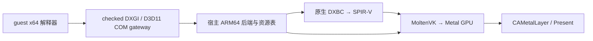

# Win64 D3D11 / DXVK / MoltenVK 接入（2026-10-08）

## 结论与当前证据

可以复用开源 D3D11 / shader 转译代码来减少自写渲染器的工作。
**当前不能通过复制 DXVK DLL + MoltenVK 就完成 wire 的游戏渲染。**
wire 既不是 Wine，也没有通用 Vulkan guest→host ABI。当前已接入原生 ARM64 图形库、
Win64 DXGI factory4 / adapter1 的64位 COM 边界。Alice 已越过设备枚举与 D3D12 能力探测，
进入 `D3D11CreateDevice`（pass88）；隐藏初始化窗口尚未显示，尚无 guest D3D11 设备或 Present。

首次检查点的两个独立探针如下；后续原生库、离屏Draw和guest重放证据见下一节。
原始游戏目录保持只读。

| 实测项目 | 结果 | 证明范围 |
| --- | --- | --- |
| 官方 public-API MoltenVK 1.4.2，Apple M4 | Vulkan 1.4.357；真实 instance / device / queue / buffer / pipeline / fence | 宿主 Vulkan→Metal 可用 |
| 独立 SPIR-V compute，经 MoltenVK 转成 MSL 并执行 | 4096 个输出逐个与 CPU 期望值一致 | shader 编译、GPU 提交、同步和读回有效；没有 CPU guest JIT |
| DXVK 的独立 `dxbc-spirv`，原样 ARM64 构建 | 成功；上游 `test_dxbc_spv` 报告 199608 个检查，0 failed | 原生 shader 翻译组件可在本机编译；不是 wire 的完整回归 |
| 隔离 `UnityPlayer.dll` 内全部合法 SHDR/SHEX 容器 | 8 / 8 转译为 SPIR-V 1.6：3 VS、3 PS、2 CS | 当前内嵌 shader 的 DXBC→SPIR-V 转译有效；未执行这批 shader，未扫描打包游戏资源 |

证据在 `wire-out/moltenvk-probe-2026-10-08/{report.json,driver.log}`、
`wire-out/dxbc-probe-2026-10-08/report.json`，上游检查日志在
`/private/tmp/wire-dxbc-tests.txt`。这不是帧率或 MIPS 对照，也不是首帧验收。

## 原生库与 guest 接入检查点

| 实测项目 | 结果 | 证明范围 |
| --- | --- | --- |
| 原生C ABI、同一UnityPlayer的8个DXBC | 8/8转译；全部通过独立spirv-val的Vulkan1.3验证 | 当前内嵌shader可转译；未扫描打包游戏资源 |
| 同一原生库、实际MoltenVK pipeline | 3组VS/PS + 2个CS成功；6组接口不匹配的组合明确拒绝 | 每个shader至少参与一个实际成功的pipeline；CS尚未dispatch |
| Unity位置/UV VS + t0/s0 PS，64×64离屏Draw | 4096个RGBA8像素逐通道读回比较，0误差 | 真实DXBC→GPU上传/采样/Draw/同步/读回；不是guest Present |
| Alice启动、真实Vulkan adapter | factory4、EnumAdapters、GetDesc与引用调用通过；D3D12明确不支持并回退D3D11 | guest连接了真实adapter信息；未创建D3D11 device/context |

证据：`wire-out/native-graphics-probe-2026-10-08/{report.json,offscreen-rgba64.png}`、
`wire-out/games64/alice/linked-pass-88.txt`。这不是性能对照或可见游戏首帧。

`src/platform/native_graphics.cpp/.h` 是独立实现的宿主C ABI v1。
`src/gpu.rs`使用私有宿主函数指针，Shader持有context/library的Rc所有权；
调用串行化，Rust与C ABI都拒绝跨context shader。最后释放才销毁device并dlclose。
失败open保留adapter输出，失败Draw保留读回输出；DXBC检查header、总尺寸、
chunk数量/范围/重叠和shader DWORD长度。这不是完整恶意shader的fuzz验收。

固定资源映射如下；register space非0、其它stage、超额register明确拒绝。
min16目前保守升为允许的32位实现。

| stage | descriptor set | CBV | SRV | sampler | UAV | push data起始字节 |
| --- | ---: | --- | --- | --- | --- | ---: |
| VS | 0 | 0–13 | 14–141 | 142–157 | 158–165 | 64 |
| PS | 1 | 0–13 | 14–141 | 142–157 | 158–165 | 128 |
| CS | 2 | 0–13 | 14–141 | 142–157 | 158–165 | 192 |

shared push data从0开始；出现push block时保留256B。反射实际SPIR-V descriptor类型、
定长数组，以及VS输出/PS输入的location、component、scalar/vector形状。
浮点控制按真实physical-device属性配置；Vulkan memory model与bufferDeviceAddress明确查询/启用。
当前graphics pipeline模板为RGBA8、triangle list、F32 position/UV布局，不是完整D3D11状态集合。

两个CS最初在MoltenVK生成的LDS零初始化循环里引用未声明的`gl_WorkGroupSize`。
shim将仅由普通U32 OpConstant构成的LocalSizeId解析成LocalSize，同时添加等价的
BuiltIn WorkgroupSize常量；拒绝specialization/dynamic维度，不删除LDS初始化或barrier。
修改位于wire shim，dxbc-spirv源码保持原样；全部生成SPIR-V已通过独立验证。

`wire_gpu_blit_rgba64`是受限离屏Draw诊断：F32x4 position/F32x2 UV、无VS资源/push block、
单2D t0与s0的PS接口。实际创建image/buffer/view/descriptor/renderpass并上传owned host数据，
提交Draw后等待fence，以显式barrier和coherent staging读回。RAII按依赖顺序销毁；
超时失败也先等已提交工作结束，避免释放GPU仍引用的资源。没有保留guest指针或连接窗口交换链。

Win64 `src/x64/runtime/dxgi.rs`的对象/vtable是runtime-owned只读页，slots仅存guest gateway。
VirtualFree/HeapFree不能释放它们，VirtualProtect不能升成可写/可执行。
宿主表维护IUnknown身份和引用；adapter持有factory，最后Release回收对象页并释放parent。
两个共享vtable页常驻，对象数有界1024。QI/枚举先preflight，fault不留对象或增加引用；
private byte data有界64KiB/64键，短buffer报告大小并保留内容；非NULL private IUnknown回调引用明确未实现。

factory支持IUnknown/IDXGIObject与factory0–4身份，adapter支持base/adapter1。
仅枚举实际打开的一个Vulkan设备，DESC/DESC1按304/312字节Win64 UTF16/UINT/SIZE_T/LUID布局序列化。
process-local LUID由device UUID派生，不是宿主指针或Windows内核LUID。
Make/GetWindowAssociation检查实际HWND与flags；尚无额外原生Alt-Enter/PrintScreen默认动作。
创建flags只接受0，debug请求返回SDK_COMPONENT_MISSING。
没有WARP/shared资源、DXGI output/通知/交换链、D3D feature-level或热插拔服务，未实现方法保留明确边界。
IsCurrent针对固定attached-device inventory，不能据此声称实现了宿主GPU热插拔跟踪。

D3D12 ordinal101/102与named CreateDevice/GetDebugInterface走同一gateway；静态、GetProcAddress
和delay-load provider一致。CreateDevice真实返回UNSUPPORTED，包括NULL ppDevice能力查询；
debug返回NO_INTERFACE，非NULL输出先检查并置NULL，不创建假device或版本号。

Alice的下一调用参数已经从真实guest stack读取：driver type=UNKNOWN、flags=`0x20`
（BGRA_SUPPORT）、SDK=7，feature-level依次为11_1 / 11_0 / 10_1 / 10_0。
没有9_x回退；本机MoltenVK的geometryShader=false，10_x及以上要求geometry能力。
因此当前8个VS/PS/CS成功也不能证明满足最低10_0。下一阶段除COM/device/context和资源外，
还需实际geometry/SO等能力补齐或具有对应实现的后端；不能仅填一个10_0/11_0使创建返回成功。
原版DXVK的必要扩展仍缺失，macOS fork降低feature请求不等于完成该语义补齐。
参数证据在`wire-out/games64/alice/d3d11-state-pass88.txt`。

## 版本与 Vulkan 功能差异

2026-10-08 读取的 [DXVK 官方 Driver support](https://github.com/doitsujin/dxvk/wiki/Driver-support)
针对 3.x 要求 Vulkan 1.4、至少256字节 push constants、descriptor indexing、
8/16/64位整数、scalar block layout，且硬性要求以下扩展：
`VK_EXT_depth_clip_enable`、`VK_KHR_maintenance5`、`VK_KHR_maintenance6`、
`VK_KHR_load_store_op_none`、`VK_EXT_robustness2`、`VK_EXT_transform_feedback`。
本机 official MoltenVK public build 的实测情况：

| 能力 | 实际值 |
| --- | --- |
| Loader / physical device Vulkan | 1.4.357 / 1.4.357 |
| maxPushConstantsSize | 4096 |
| descriptorIndexing / scalarBlockLayout / shaderInt8 / shaderInt16 / shaderInt64 | true |
| maintenance5 / maintenance6 / load_store_op_none / robustness2 | 有对应扩展 |
| depth_clip_enable / transform_feedback | **没有**对应扩展 |
| geometryShader / shaderCullDistance / logicOp / shaderFloat64 | false |
| tessellationShader | true |

`probe_moltenvk.py` 只报告已检查的必要条件缺口；没有把扩展名存在等同于
该扩展所有 feature bits、limits、格式及实际 shader 都可用。
因此原版 DXVK 3.x 在这里不具备直接工作的必要条件。
MoltenVK 会按 instance 请求版本限制 physical-device 的版本报告；探针请求最高已知版本，
不能用请求 Vulkan 1.2 后看到的 1.2 报告推断驱动最多支持1.2。
跨 GPU / OS / MoltenVK 版本必须重新查询，不能硬编码上述 M4 结果。

[Gcenx/DXVK-macOS](https://github.com/Gcenx/DXVK-macOS/tree/1.10.x) 的1.10.x分支
确实有 macOS 适配，但仍是供 Wine 使用的 Windows DLL，说明要求只覆盖
`d3d11` / `d3d10core`。它修改了 `D3D11Device::GetDeviceFeatures`，
将 geometry、transform feedback / geometry streams、shader cull distance 和 tessellation
等请求改为跟随实际支持；`CreateGeometryShaderWithStreamOutput` 缺少 transform feedback 时失败。
这解释了为何它能用于一些 macOS 游戏，却不证明它实现了完整的 D3D11 feature level。
不能直接把它的降要求策略照搬为 wire 对不支持功能的成功声明。
其中 DXGI 仍需 Wine 路线或新的宿主适配，不会替 wire 自动完成 factory / adapter / swapchain。

旧 [DXVK Native](https://github.com/misyltoad/dxvk-native) 的 master 是1.9.2，仓库已归档。
其 Linux平台服务、`/proc/self/exe`、x86 intrinsics、SDL2 WSI，以及设备创建时强制请求
geometryShader，都需要适配；降低到这个版本仍不能直接用。
现代 DXVK 上游也已有原生构建入口（SDL2/SDL3/GLFW），但完整设备需求仍存在。
“原生构建”不能等同于“Apple GPU已支持完整DXVK”。

## 选择的边界

优先推进**宿主 ARM64 转译后端**，保留 guest CPU 解释器为主路径。
先复用可独立构建的 `dxbc-spirv`，以 MoltenVK 为 GPU 路线；完整 DXVK 的原生适配
作为后续可替换后端，在能力验证通过前不把它设成已可用依赖。
这样先省掉自写 SM4/SM5 解码、优化和 SPIR-V 生成，仍需实现 D3D11 对象与状态的边界。
此决定没有承诺完整 DXVK 会比直接 Metal 更快完成移植；本轮只验证了最先可以复用的组件。



`dxbc-spirv` 的 shader IR 与 wire 的 x86 IR 是不同的指令集。
shader 转译不执行 x86 CPU 机器码；MoltenVK 使用 GPU shader 编译器不等于允许宿主 x86 JIT。
这两点也不构成 App Store 审核保证。仅使用公开 Metal API的构建，当前探针不使用 privateapi 包。

另一路“解释 guest DXVK PE DLL → Vulkan thunks → MoltenVK”保留为比较选项，
但会增加 DXVK 的 guest C++ 指令、Win32/CRT/线程服务和 Vulkan 的结构/回调/映射转换。
当前 provider 还硬路由 `dxgi.dll` / `d3d11.dll`，没有 DLL override 策略。
本次选择原生组件路线，没有新增一套 PE Vulkan 解释执行路径。

## COM、资源、shader 和窗口必须实际接通

1. guest 对象的8字节 vtable slots 只存 gateway 地址；宿主接口/函数/MTL对象指针
   只存宿主资源表。IUnknown身份、QueryInterface / AddRef / Release、设备子对象的设备引用、
   销毁顺序与失败回滚必须可验证，不能用常驻伪句柄跳过生命周期。
2. guest 参数按 Win64 布局完整检查并复制，处理 DWORD / SIZE_T / UTF16 / GUID、
   数组长度、subresource row/depth pitch。原生 C++ ABI、32位宿主 wchar_t、原生窗口指针
   不等于 Windows ABI；不能把宿主结构直接 memcpy 给 guest。
   所有 guest 输出先检查，失败不能创建一半对象、消费一半上传或留下无法释放的 native 引用。
3. Map 返回 checked guest staging 地址；Unmap 才按真实 pitch / 范围提交。
   GPU fence 完成后才能读回或复用 storage。动态资源、decommit、异常和预算暂停
   不允许宿主保留失效 guest pointer；未支持 Map / usage / format 明确失败。
4. `dxbc-spirv` CLI 的 BasicResourceMapping **不是 D3D11 binding ABI**。
   正式库入口需要按 stage / CBV / SRV / sampler / UAV 建立资源映射，生成 descriptor / push-constant
   布局，并按物理设备查询选择 Vulkan memory model、buffer device address、float controls、
   precision / denorm / signed-zero语义。不能将 CLI 转译成功当作 pipeline 已能创建或绑定。
   SPIR-V1.6、每个 capability / extension、图像格式和 shader stage 都须检验。
5. native GPU worker 仅处理 owned host 资源和快照，不直接重入 guest Cpu / Memory / WNDPROC。
   guest 回调仍由进程执行器恢复，保留完整 FLAGS、异常、工作预算与线程状态。
6. Present 的 guest HWND 通过既有表映射取得 native window / CAMetalLayer，
   使用 `VK_EXT_metal_surface` 与 portability 配置。
   在 guest 请求可见前，资源或离屏 surface 可以存在，不能强制显示隐藏初始化窗口。
   swapchain image、resize、帧延迟、设备/窗口销毁必须处理实际 ownership；
   不将 Vulkan surface、swapchain 或 CAMetalLayer 地址暴露给 guest。

能力报告以 backend 已实际实现并通过验证的范围为准。
geometry / SO / logicOp 等缺失不能通过调低校验就变成支持；
如果游戏确实使用它们，需要真实 emulation 或适合的后端。
不能仅为了过启动而广告完整11_0后在对应调用返回假的成功。

## 接续工作与验收

| 顺序 | 实现 | 必须留下的证据 |
| --- | --- | --- |
| 已完成 | 官方 MoltenVK 独立GPU执行；原生DXBC转译 | checked读回、真实设备功能、8个实际内嵌shader的转译结果 |
| 已完成 | 原生shader库的C边界、资源映射与离屏Draw | malformed container/短输出/跨context拒绝；8shader验证、5pipeline、4096像素读回 |
| 部分完成 | Win64 COM / factory、adapter；D3D12能力回退 | 真实adapter/引用/布局/失败原子性；Alice到D3D11CreateDevice；下一步device/context与资源 |
| 之后 | 交换链与离屏Draw，再接Present / visible窗口 | 实际guest命令输出可对照像素，再取得可见游戏首帧 |
| 同步完成 | Win64 MSG、输入、等待、resize / close | 真实宿主事件进入guest WNDPROC；不能仅展示独立探针窗口 |
| 首帧后 | 持续运行与CPU/GPU耗时profile | 真实游戏持续负载、首帧时间与帧时间；不以探针替代性能收益 |

## 许可与来源

已核查具体源码 / 发行包，不使用 CrossOver、GPTK、其他应用内部 dylib 作为可分发依赖。
本轮没有引入任何 QEMU GPL 实现、Wine图形运行库或DXVK整库源代码。

| 项目 | 核查版本 | 许可与处理 |
| --- | --- | --- |
| DXVK / DXVK-macOS | macOS commit `8f1e28deed3ad30802f7e1bdff428ec14e6e7817` | zlib/libpng；允许使用/修改，保留notice并标记修改；本轮仅审阅 |
| 旧DXVK Native | `c8dc91fabd00cac11d697ccf07426e798393cd40` | zlib/libpng主体；其内嵌Win32/Vulkan头文件须分别核查；本轮仅审阅 |
| dxbc-spirv | `c7f069701227dcb800a01bd93e42f8001b7543e7` | MIT，Copyright (c) 2025 Philip Rebohle；可链接/移植，保留完整许可与版权 |
| 编译器的SPIR-V Headers | `c8ad050fcb29e42a2f57d9f59e97488f465c436d` | 实际编译的统一头文件标MIT，保留Khronos版权与许可；没有使用文档的CC-BY代码生成物 |
| MoltenVK | official `v1.4.2` public macOS包 | Apache-2.0，保留该组件独立许可；不把其源码并入LGPL-2.1-only源文件或重新许可 |
| Vulkan Headers | official包内1.4.357头文件 | Apache-2.0 OR MIT，选择MIT；由外部SDK提供 |

MIT / zlib组件可在保留各自notice的前提下用于当前LGPL-2.1-only工程。
MoltenVK保持独立动态组件及其Apache-2.0版权/许可/NOTICE和依赖notice；
wire的LGPL源码、修改和用户重建/替换权利仍须保留。
不能以“动态链接”三个字代替组合/分发条件核查，也不能把Apache-2.0源码复制后统一标LGPL-2.1-only。
原生库与工具只加载明确提供的外部SDK，没有打包第三方二进制。
默认cargo build与Wire.app不携带这些依赖；可选probe64显式加载自有ARM64 shim，
该shim静态链接MIT dxbc-spirv，独立动态加载Apache MoltenVK。此布局须保留LGPL重建/替换权利；
分发shim/MoltenVK时还需提供实际包的全部NOTICE与依赖notice。
正式打包时须把具体链接布局、完整依赖notice和可重建材料一起纳入分发检查。
工具涉及的许可文本在 `licenses/third-party/`、来源登记在 `THIRD_PARTY_NOTICES`。

官方MoltenVK包：
`https://github.com/KhronosGroup/MoltenVK/releases/download/v1.4.2/MoltenVK-macos.tar`，
SHA-256 `f95765a6229cb7b915990a2890ce12ebe36a730b021545d3d52ae69ce4c4024e`。
不要误用同一release中的`macos-privateapi`包。

## 复跑

工具不下载或安装依赖；SDK / 编译器由显式路径提供。

```sh
python3 tools/probe_moltenvk.py \
  --include /private/tmp/wire-moltenvk-1.4.2/MoltenVK/MoltenVK/include \
  --library /private/tmp/wire-moltenvk-1.4.2/MoltenVK/MoltenVK/dynamic/dylib/macOS/libMoltenVK.dylib \
  --out wire-out/moltenvk-probe-2026-10-08

# 固定commit的dxbc-spirv源码须带上述固定的SPIR-V Headers子模块。
# 本轮使用Meson1.9.2、Apple clang21和ninja，以release原样构建。
meson setup /private/tmp/wire-dxbc-spirv-build /private/tmp/dxbc-spirv-main \
  --buildtype release -Denable_tools=true -Denable_tests=true
ninja -C /private/tmp/wire-dxbc-spirv-build
python3 tools/probe_dxbc.py \
  --compiler /private/tmp/wire-dxbc-spirv-build/tools/dxbc_compiler \
  --input wire-out/games64/alice/runtime/UnityPlayer.dll \
  --out wire-out/dxbc-probe-2026-10-08
```

probe_moltenvk仅在明确提供的dylib中解析公共Vulkan入口，处理portability枚举与device extension，
初始化输出为哨兵值，真实dispatch、shader→host barrier、fence等待、noncoherent flush/invalidate
后逐字校验，失败返回非零。它没有guest接口，也没有临时生成CPU机器码。
probe_dxbc检查容器/所有chunk范围与重叠、按完整payload SHA去重，保存上游日志，
检查输出SPIR-V header/record边界；不校验其全部shader语义，也不替代GPU pipeline验证。

### 当前原生库 / guest 重放

```sh
python3 tools/build_native_graphics.py \
  --vulkan-include /private/tmp/wire-moltenvk-1.4.2/MoltenVK/MoltenVK/include \
  --dxbc-source /private/tmp/dxbc-spirv-main \
  --dxbc-library /private/tmp/wire-dxbc-spirv-build/libdxbc_spv.a \
  --out wire-out/libwire_graphics.dylib
python3 tools/probe_native_graphics.py \
  --backend wire-out/libwire_graphics.dylib \
  --moltenvk /private/tmp/wire-moltenvk-1.4.2/MoltenVK/MoltenVK/dynamic/dylib/macOS/libMoltenVK.dylib \
  --input wire-out/games64/alice/runtime/UnityPlayer.dll \
  --out wire-out/native-graphics-probe-2026-10-08 \
  --validator /private/tmp/wire-spirv-tools-build/tools/spirv-val

cargo build --release
cd wire-out/games64/alice/runtime
../../../../target/release/wire probe64 AliceToPapaADV_1-0-0.exe \
  --max-instr 200000000 --startup --window \
  --graphics-backend /Users/alphaly/Projects/wire/wire-out/libwire_graphics.dylib \
  --moltenvk /private/tmp/wire-moltenvk-1.4.2/MoltenVK/MoltenVK/dynamic/dylib/macOS/libMoltenVK.dylib
```

两个graphics路径参数必须成对提供，隐含startup；没有后端时DXGI明确拒绝。
构建脚本记录命令与shim/source/static-lib/output SHA-256，不自动下载、安装或证明传入的上游revision。
本次独立spirv-val为SPIRV-Tools v2025.2，配其DEPS固定Headers
`aa6cef192b8e693916eb713e7a9ccadf06062ceb`，仅用于验证，不链接runtime。
原生Rust的ignored生命周期/所有权/Draw测试使用以下环境变量（输入均是隔离探针提取的DXBC）：

| 环境变量 | 值 / 样本SHA前缀 |
| --- | --- |
| WIRE_NATIVE_GRAPHICS | 编好的libwire_graphics.dylib绝对路径 |
| WIRE_MOLTENVK | 官方public libMoltenVK.dylib绝对路径 |
| WIRE_DXBC_VERTEX / WIRE_DXBC_PIXEL | 061ea774 / e8ef222f 对应.dxbc绝对路径 |
| WIRE_DXBC_COMPUTE | ff9a4e9b 对应.dxbc绝对路径 |
| WIRE_DXBC_BLIT_VERTEX / WIRE_DXBC_BLIT_PIXEL | 30e1f7ac / aaaff3e4 对应.dxbc绝对路径 |

然后运行 `cargo test --release --lib gpu::tests -- --ignored --nocapture`。
默认全回归不会隐式加载/tmp中的第三方依赖；原始游戏、DXBC和SPIR-V均不提交入库。
