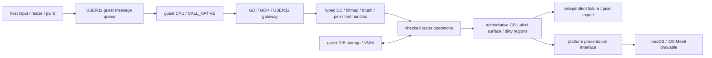

# 图形渲染实施设计（2026-10-06）

本页是 VMM 完成后的实施准备，不表示渲染后端已经实现。
当前解释器为主路径，Wasm/JSC 仍是可用时的加速路线。图形 API 经现有 CALL_NATIVE/gateway 进入 host 后端，
先建立可验证的像素与 Win32 对象语义，再接入 Metal 呈现。

## 从当前实测入口开始

游戏已经装载 layerExDraw 并调用 GdiplusStartup；绘图功能尚未调用成功。
现阶段有两个逻辑窗口 TVPQueueWindow / TVPTimerWindow，尚未到达可见游戏主窗口。
初始化实际执行 `GetDC(NULL)`、`CreateCompatibleDC`、`CreateCompatibleBitmap(1,1)`、`SelectObject`，
以及各 **768 次 SetPixel/GetPixel**。目前这些函数仍是零返回的未实现路径，不能当作真实 framebuffer。
第一份独立渲染 fixture 应重现这个像素探测流程，并额外验证有代表性的 bitmap/blit 输出。

游戏当前直接阻塞在 menu.dll 的静态导入，首先补菜单对象的真实逻辑，才能继续观察后续绘图调用。
该插件 USER32 导入包括 InsertMenuItemW、CreateMenu/CreatePopupMenu、GetMenuItemCount、RemoveMenu、
SetMenuItemInfoW、GetMenu/SetMenu、DrawMenuBar、TrackPopupMenuEx、ClientToScreen、RedrawWindow、
MapVirtualKeyW、LoadStringW、IsWindow、GetKeyNameTextW。
菜单句柄、item id/position、submenu、字符串/state/data、窗口归属和销毁须有实际状态；
未实现交互不能用伪句柄或默认成功代替。菜单回调与 WM_COMMAND 复用既有 guest callback/控制权边界。

## 对象与像素路径

- 对象表按类型验证句柄与生命周期，DC 保有 selected bitmap/brush/pen/font/clip 和绘图状态。
  SelectObject 返回真实旧对象；不能删除仍选入 DC 的 bitmap；stock object 不按普通对象释放。
  窗口 DC 与 compatible memory DC 分开，GetDC/ReleaseDC 和 CreateCompatibleDC/DeleteDC 分别验证配对。
- DDB 可使用 host owned 像素；DIB section 必须返回真正的 guest 数据地址。初期只支持明确验证的格式，
  首选 32bpp BI_RGB，并实现 BITMAPINFO stride、signed height/top-down 与 bottom-up 行序。
  COLORREF 是 0x00BBGGRR，内部 surface 明确采用 BGRA8；GDI 的 alpha 与 GDI+ 的 premultiplied alpha 分开处理。
- 所有宽高/stride/长度计算用 checked arithmetic，限制 bitmap 大小；输入/输出先验证完整受影响 guest 范围。
  DIB direct CPU writes 要进入数据页 dirty/generation 观察，不能只跟踪 host API 写入；
  storage 解除映射/释放后不能继续持有裸 host pointer。Metal 上传取得快照，避免跨 guest API 保留无效指针。
- CPU surface 在初期是像素真值，GetPixel/截图/读回均从同一份数据获得。
  GPU 先承担上传、缩放和显示；GPU 栅格化留到读回、混合精度和同步可验证后再接入。
  Dirty rect 合并到 paint/frame 边界提交，避免每个 SetPixel 都上传或呈现。

计划模块为 `graphics/{objects,surface,dib,raster,present}`，分别承载句柄、存储、DIB 转换、绘图语义和平台呈现。
这些模块尚未创建；先用独立 fixture 确认接口和生命周期，再增加对应实现。
当前 gateway 只缓存前 12 个 DWORD 参数，StretchDIBits（13 DWORD）/CreateFont（14 DWORD）等接入前，
必须扩展 checked ABI 参数读取，不能让后续参数静默丢失。

## 实施与验收顺序

| 阶段 | 实际实现 | 验收证据 |
| --- | --- | --- |
| 1 | 菜单对象和必要坐标/重绘状态；解除 menu.dll 装载边界 | 独立 menu/item fixture，真实 DLL 初始化继续，无假成功 |
| 2 | DC、bitmap、SelectObject/GetObject/DeleteObject、SetPixel/GetPixel、CreateDIBSection/GetDIBits/SetDIBits | 1×1 探测逐色读回正确；彩色棋盘、行序、pitch 和边界像素逐字节验证 |
| 3 | BitBlt/StretchBlt/SRCCOPY、PatBlt/FillRect、clip/origin、基础 AlphaBlend | 非零 origin、裁剪、同源目标重叠、bottom-up DIB 与透明混合 fixture；导出真实像素产物 |
| 4 | GDI+ brush/path/graphics/image 对象与实际游戏命中的 draw API | 复用已移植矩阵语义；未支持项保持 NotImplemented；独立形状/图像 fixture 与游戏调用对应 |
| 5 | macOS 可见窗口/Metal 上传呈现、resize、paint、输入消息 | 真实游戏画面可见并刷新；resize/窗口销毁不悬空；输入驱动实际 guest 响应 |
| 6 | 字体资源/CoreText 或选定字体后端、CP932/UTF16、codec 与剩余像素格式 | 已登记字体确实可枚举/选择/渲染，文本与图片 fixture，以及实际游戏文本/资源画面 |

不把整个 Win32/图形 API 表一次性填成成功。ROP、palette、复杂 region、font/codec、DirectDraw 等，
按实际命中和可验证范围逐项实现；未支持路径继续记录明确失败。
字体/codec 等如果成为新的实际阻塞，可提前实现所需范围；上述顺序按游戏进展调整。
可以直接移植 Wine 的平台无关处理逻辑。每次读取新文件先核查许可和依赖；
保留版权/commit/快照/notice，Wine server、X11/Wayland 和驱动调用由 wire 的窗口/图形后端替代。

## 呈现与解释器边界

平台接口接收 surface 快照/dirty 区域及逻辑窗口 identity，返回输入/resize/close 事件；
host 事件转 guest 消息，经现有线程队列和 WndProc 执行，不直接从任意 host 回调重入 Cpu。
事件 polling 和 frame 提交放在可控的 cooperative 边界，保留 guest 预算/分时/FLAGS 恢复规则。
macOS 先验证公共系统图形 API，再移植 iOS 的 view/CAMetalLayer 生命周期；系统 UI 线程与解释执行线程要有明确 ownership。

最初不改变 guest 指令统计口径。进入可重复的持续主循环后，分别测启动、文本、图像/透明层场景，
预热后每次至少 60 秒并重复多次；同时记录 guest MIPS、帧时间、API/raster/presentation/解释器 profile。
初始化失败处的约 289M 指令不能代替持续渲染负载，也不能与旧短启动 MIPS 混算收益。
