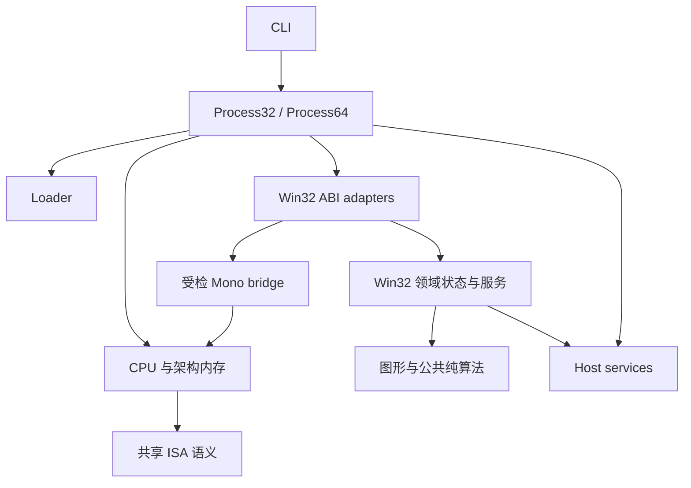

# Wire 渐进式重构计划（2026-10-11）

状态：待实施。本次只审计代码并制定计划，没有修改运行时代码，没有重新运行编译、测试或性能测量。

审计基线：主目录 `/Users/alphaly/Projects/wire`，HEAD `10731e1`。Mono 仍按存在并行开发处理；实施前必须重新固定基线，不能将本文的位置、测试计数或启动终点视为永久状态。

## 1. 判断与目标

项目仍明确以 feasibility spike 定位，但已经积累了约 8 万行自有实现、两种 guest 架构、图形后端和原生 Mono 诊断路径。继续按“遇到缺口就在总分发器追加分支”的方式开发，修改成本会越来越高。

用户指出的可维护性问题成立，尤其体现在 **同一规则多处声明、进程状态没有明确所有者、实验协议与通用实现交织、当前文档与历史结果混杂**。这次抽样审计没有证明“多数分支都是无意义硬编码”；ISA、Windows ABI 和受检跨架构桥本来就需要精确分支。重构目标应是让规则只有一个权威来源、状态只有明确的所有者，而不是追求 `if` / `match` 数量下降。

建议顺序：**冻结行为基线 → API 契约试点 → 收敛分发与状态 → 建立 PE32 进程边界 → 整理 host/graphics 边界 → Mono 协议重构 → 文件、工具、文档收尾**。其中 Mono 等待稳定窗口，其余阶段可以独立推进。

完成后的工作方式应是：新增一个普通 API，通常只需修改所属领域的契约声明、架构适配器、领域实现及对应测试；不再同时维护根分发器、多张 ABI 表和多个“支持列表”。未知能力有可解释的结果，版本限定规则能追溯到输入与证据。

## 2. 当前证据

统计范围为 `git ls-files` 中 `src/`、`tests/`、`tools/`、`examples/` 下的 `.rs/.py/.c/.cpp/.m/.h/.sh` 文件，按物理行计数，包含注释和空行。排除未跟踪文件、`target/`、`wire-out/` 和 `third_party/`；C#、IL、Metal shader 等不在这一口径内，因此不是整个仓库总量。

| 范围 | 文件数 | 物理行数 |
| --- | ---: | ---: |
| `src/` | 163 | 79,956 |
| `tests/` | 19 | 25,802 |
| `tools/` | 49 | 11,469 |
| `examples/` | 8 | 1,322 |

另有 57 个跟踪的 `docs/` 文件、84 个跟踪的 `tools/` 文件（此处不限扩展名）。文件长度仅用于定位审查热点，不作为拆文件的唯一依据。

| 证据位置（基线行号） | 观察 | 维护影响 / 优先级 |
| --- | --- | --- |
| [runtime.rs](/Users/alphaly/Projects/wire/src/x64/runtime.rs:216)，5,304 行 | `import_supported`、`kernel_export`、`import_arity`、`normalize_symbol`、`import_dwords`、`import_groups` 分别表达同一组 API 的不同属性；`dispatch_bound` 本身从 1437 行延伸到 5217 行 | 新 API 容易漏改某张表；需要跨表推断路由和 ABI。P1 |
| [gateways.rs](/Users/alphaly/Projects/wire/src/x64/runtime/gateways.rs:25) | 已有 `BoundImport`，绑定时保存 arity/dwords/groups/hot，调用时使用专用热路由 | 已有正确的“冷绑定、热执行”雏形，应扩展它，而不是另造逐调用查字符串的注册框架。P1 |
| [api.rs](/Users/alphaly/Projects/wire/src/api.rs:509)，3,493 行；[win32_abi.rs](/Users/alphaly/Projects/wire/src/win32_abi.rs:33) | PE32 手写栈清理表叠加 Wine spec 表；ABI 已知不等于实现完整。`dispatch` 还以 DLL 名推测 cdecl，对部分调用默认读取 12 个参数，未知 ABI 保留零清栈诊断路径 | ABI 来源、实现状态与未知策略需要分开；不能在搬表时顺便改变栈行为。P1 |
| [api.rs 的状态](/Users/alphaly/Projects/wire/src/api.rs:197)；[Runtime64 状态](/Users/alphaly/Projects/wire/src/x64/runtime.rs:79) | 文件、模块、线程、TLS、COM、图形等集中于大状态对象；不少子文件依然通过 `impl Runtime64` 操作总对象的字段 | 已拆文件，但部分职责并未形成独立边界。P2 |
| [cpu.rs](/Users/alphaly/Projects/wire/src/cpu.rs:2958)，3,206 行；[main.rs](/Users/alphaly/Projects/wire/src/main.rs:204)，1,037 行 | PE32 CPU 的 `run_loop` 负责 API、DLL 通知、协作调度和平台轮询；CLI 负责构造内存、装载器、运行状态及报表。AMD64 已有 `Process64` | 两种架构的进程边界不对称；CPU 语义与进程编排混在一起。P2 |
| [platform.rs](/Users/alphaly/Projects/wire/src/platform.rs:3)；[graphics/mod.rs](/Users/alphaly/Projects/wire/src/graphics/mod.rs:6) | 平台轮询直接依赖 `ApiState/GuestMem/Sched`；像素与 GDI 分发也位于同一模块体系 | host 层向上了解 guest 运行状态，图形核心难以独立复用。P2 |
| [Mono Probe](/Users/alphaly/Projects/wire/src/x64/process/mono_startup.rs:195)，2,953 行 | 大量“阶段启用 / 阶段 ready”布尔值；`new` 用字符串集合表达前置阶段，`stop_before` 和 `startup_limit` 又维护阶段关系 | 增加一个启动阶段需要修改多处，合法状态依赖人工保持。P2，等待 Mono 稳定窗口 |
| [Mono 指纹选择](/Users/alphaly/Projects/wire/src/x64/process/mono_startup.rs:297)；[bindings.rs](/Users/alphaly/Projects/wire/src/x64/process/mono_startup/bindings.rs:9)；[invoke.rs](/Users/alphaly/Projects/wire/src/x64/process/mono_startup/invoke.rs:327) | runtime/support hash 配对、精确 Unity RVA、metadata token、方法签名与启动次序分散在实现中 | 需要集中版本协议，但这些检查具有正确性意义，不能删除或用宽松匹配代替。P2 |
| [tests/x64.rs](/Users/alphaly/Projects/wire/tests/x64.rs:2031)，13,818 行；[tests/win32.rs](/Users/alphaly/Projects/wire/tests/win32.rs:1254)，6,226 行 | 测试覆盖广，但大量领域共用大文件和私有 harness | 定位、按领域验证和并行修改成本高；先拆 harness，再按行为迁移测试。P1/P2 |
| [interpreter_v2_perf.py](/Users/alphaly/Projects/wire/tools/interpreter_v2_perf.py:16)；[api_inventory.py](/Users/alphaly/Projects/wire/tools/api_inventory.py:455) | V2 性能工具要求外部 `--audit-probes` Python 模块；inventory 还将源码字符串扫描作为候选线索，另可接 coverage helper | 正式验收 fixture 应版本化；候选名称不能被当成实现覆盖。P1 |
| [README](/Users/alphaly/Projects/wire/README.md:1)，[近期 Mono 交接](/Users/alphaly/Projects/wire/docs/native-mono-handoff-2026-10-09.md:1) | README 仍主要介绍早期 PE32/M2 阶段；近期 Mono 文档已经记录真实 Unity 对象分配，完整游戏 Admission 仍为 false | 缺少可信的当前状态入口。P1 |

需要保留现有积累：`fs` 的受限路径模型、共享内存 owner/lease、精确浮点 helper、typed IR、`BoundImport` 热路由，以及 Mono 的 registry/root/session 等模块均已有可复用边界。不要全部重写。

## 3. 先分类规则，再决定抽象

| 规则类别 | 处理方式 | 例子 |
| --- | --- | --- |
| ISA 与 ABI 规范 | 使用 enum、具名常量、typed decoder/codec；保留静态专用分支 | 指令 dispatch、FLAGS、Win64 FLOAT 的 XMM 位置、stdcall 清栈 |
| 可枚举 API 元数据 | 汇入领域注册声明；在装载/绑定阶段得到紧凑 ID | DLL 归属、别名、arity、参数宽度、领域路由 |
| 通用服务语义 | 放到拥有状态的子系统；必要时抽取纯算法 | 文件路径、GUID 解析、计时转换、handle 生命周期 |
| 虚拟环境取值 | 放入具名、不可变的 guest 环境描述 | `WIRE/wire` 身份、Windows 版本、CP932 默认值、guest Users 路径 |
| 精确版本协议 | 由静态 profile 绑定 hash、布局、token/RVA、签名、已证明能力 | Unity/Mono startup probe |
| 尚未实现或部分支持 | 显式记录能力、限制与返回策略 | 无 wave 输出设备、MCI backend 不可用、未准入 InternalCall |

“虚拟环境值”并不自动等于假的成功。比如 guest 计算机名为 `WIRE`、无音频设备返回规定错误，均可有自洽语义。真正需要清理的是没有契约、不可解释、掩盖缺失能力的返回值。逐项审核，不做全局“零返回 = 未实现”推断。

不引入通用脚本规则引擎、运行期可任意修改的 ABI 配置或为每条指令创建 trait object。数据驱动只覆盖确实可声明的规则；状态转换与异常提交继续使用可审查的代码。

## 4. 推荐的模块边界

先保留一个 Cargo crate。目录是逐步形成的目标，不要求第一批就创建全部空目录或移动所有文件。

```text
src/
  main.rs                         # 命令入口
  cli/                            # 参数、命令调用、终端报表
  abi/                            # guest 地址类型、Win32/Win64 布局 codec
  isa/                            # 已证明可共享的纯指令语义，如精确 SSE FP
  runtime/                        # 公共宿主服务、guest 环境、诊断类型
  win32/
    catalog/                      # 领域 API 声明与绑定
    x86/                          # PE32 调用/返回适配、阶段性运行状态
    x64/                          # Win64 调用/返回适配
    kernel/                       # 文件、模块、同步等领域语义
    user/                         # 窗口、消息、输入
    gdi/                          # GDI ABI 与对象语义
    com/                          # 自动化、接口契约
    graphics/                     # D3D9 / DXGI / D3D11 guest 接口
  x86/
    process.rs                    # PE32 进程编排
    cpu/                          # PE32 CPU/raw/IR 执行
    memory/                       # PE32 地址空间及代码失效
    pe/                           # PE32 读取与装载适配
    ir/                           # .wir v3 与 PE32 runtime descriptor
  x64/                            # 保留现有 AMD64 CPU/memory/PE/process 边界
  mono/                           # 已有 session/roots/buffers；未来可复用 bridge
  graphics/                       # 像素、几何、资源核心，不依赖 ApiState
  host/                           # UI / 音频 / 字体 / 计时 / native graphics FFI
```

Win64 的 `x64::runtime` 和 PE32 的 `api` 等旧入口先作为 facade 保留。`win32/x86`、`win32/x64` 只放实际需要的架构适配器；尚未共享的实现留在原模块，不创建两套同名空壳。Mono startup probe 暂留 `x64/process/mono_startup`，不能仅凭文件夹改名就称为通用后端。

建议依赖方向如下；箭头表示调用或依赖：



领域代码通过明确的内存参数/受检 codec 操作 guest 内存；可产生回调请求，由 Process 执行回调。避免领域代码自行运行 CPU，也避免 host 层反向导入整个 Process/ApiState。共享 ISA 语义不依赖 Win32、图形或 Mono。这是迁移终点；现有回调环需要逐步解除，不能在第一次抽取时强行改完。

### 4.1 API 契约：一个权威声明，冷阶段绑定

每个 API 家族维护一份 Rust 静态声明，记录以下维度，具体类型由试点决定：

- export 身份：DLL 集合、命名/序数导出、合法别名、函数或数据导出；原始名称保留用于诊断。
- 各架构 ABI：cdecl/stdcall/Win64、参数 slot 与宽度、signedness、FP 寄存器/返回位置；varargs、sret 和 callback 使用显式专用适配器。
- 实现路由：领域 enum/handler ID，支持的架构；热 API 使用现有 `HotImport` 专用路径。
- 语义范围：完整实现、受限子集、明确不可用；限制与回归证据的标识。
- 错误约定：BOOL/LastError、HRESULT、NTSTATUS、CRT errno 等；输出行为由领域 handler 表达。

ABI 已知、存在路由、能力当前可用、真实行为已验证是不同维度，不能再压成一个 `supported` 布尔值，也不能按单一等级推导全部能力。

流程为 `DLL/export 解析 → 唯一契约 → 架构绑定计划 → typed handler ID → 执行`。哈希/字符串解析只发生在注册或 lookup 阶段；调用时继续使用有界 gateway/stub lookup 和静态分发。32 位 stub 地址布局、序数映射与 data export 存储不变。

Wine spec 是 ABI 的来源之一，不是实现清单。先收敛到一个解析来源与显式 override 表，记录 override 原因；现有优先级先保持。只解析有类型且适用架构的声明，不为 ordinal-only/stub 项发明签名。运行期 spec 解析是否迁到构建期，待试点证明收益后再定；不先增加一套通用代码生成系统。

表间不一致先作为审计差异处理；必须解释或阻止迁移，不能自动取“最大 arity”或默默覆盖。自动检查契约重复、alias 冲突、参数索引越界、ABI 已知却无明确执行策略等。数值、错误行为仍以独立 fixture 验证，不能让所有测试只从同一张表生成期望值。

### 4.2 调用框架与领域状态

调用适配器负责参数取值、架构截断、返回 frame、LastError/errno 位置和 trace；领域 handler 负责业务语义与受检内存访问。把 `(ret, note, implemented)` 等结果逐步替换为具名结果类型。

阻塞、callback、module load、present、异常、退出等仍是显式 control outcome。首先保留各架构不同的 outcome；不要为了复用建立万能 `Context`、`Any` 服务容器或把所有 CPU 寄存器塞进公共 call object。

子系统分批拥有自己的字段，例如 `ModuleState`、`ThreadState`、`FileState`、`ComState`。共享 clock/fs 等服务借用明确资源，不把每个对象都装入 `Arc<Mutex<_>>`。handle 的数值和释放/别名规则先保持，不同时换成全仓统一 generation arena。

回调前后、失败输出与 CPU 提交顺序是契约的一部分。不能套用“先验证全部参数、最后原子提交”的万能事务模板：有些 Windows API 允许部分输出，有些现有路径要求 output alias return address 时先保存返回 frame。每个家族保留自己的提交语义。

### 4.3 32/64 位共享的边界

共享优先级：**纯算法 → guest 环境值和领域模型 → 已证明等价的行为核 → 架构适配器**。

可先共享 GUID、日历/文本算法、路径规范化等。已共享的 `fs`、`codepage`、`simd` 继续复用。指针、handle、SIZE_T/ULONG_PTR、TEB、CONTEXT、结构布局、调用/清栈、异常与回调 frame 仍分别建模。Windows LLP64 下 DWORD/LONG 保持 32 位，不能因为 guest 为 x64 就全部读取成 u64。

在 API/FFI 边界渐进引入 `GuestAddr32`、`GuestAddr64`、专用 token 类型及 checked offset；不要一次给 CPU 热循环全部整数包 newtype。guest 结构使用显式大小、偏移、little-endian read/write codec；不能直接以宿主 `repr(C)` 指针解引用 guest 内存。宿主 Mono 结构与 guest snapshot 的编码仍应分开。

PE32 `GuestMem` 的 4GiB 预留模型与 AMD64 稀疏 Memory/shared backing 生命周期不同。先保持两个实现；共享访问语义的测试与纯 helper，不强制合成一个泛型 Memory/CPU/Process。

### 4.4 环境、能力与未知行为

`GuestEnvironment` 收拢 guest OS 版本、身份、locale/codepage 和路径配置，默认值保持现状。虚拟 CPU/设备能力单独描述，不宣称任意宿主环境等同于模拟 Windows。host 时间、随机数等不可重复输入只有在测试模式才注入固定 provider。

能力表描述领域的实际子集与配置条件，诊断记录 `AbiUnknown / Unsupported / InvalidArgument / GuestFault / CapabilityUnavailable / BackendRejected` 等原因；返回到 guest 的错误码仍由具体 API 映射。先在 API 边界建立类型化错误，CLI 再格式化，不一次替换所有 `String` 错误。

重构阶段保持 PE32 现有未知 ABI 的诊断/零清栈行为和 Win64 现有拒绝行为，显式标记 PE32 为 legacy policy，不能把猜测当作已知 ABI。将来更严格的默认拒绝策略应单独提出行为变更，独立回归；不能藏在搬表或拆文件中。

### 4.5 Mono：先集中协议，再迁移状态机

现有 fingerprint、RVA、metadata token、字段 offset 不是随意的游戏 workaround，而是当前有限准入的必要条件。创建静态 `VerifiedMonoProfile`，集中描述原始 DLL/Unity/assemblies hash、runtime/support 配对、布局、typed adapter 与证据标识。profile 的选择继续严格核对输入，不接受名称近似、不因配置而启用未知 native pointer。

把 `boundary: &str` 解析为 `StartupBoundary`，用明确前置条件计算“本次请求允许走到哪里”。另建 `ProbeProgress` 保存实际完成的事件和证据；请求阶段不等于完成阶段。安装顺序可用具名 step 表，但 root/image/metadata/GC/ownership 证据可能是独立维度，不能只用递增 ordinal 或 `current >= requested` 推导全部完成。

状态机负责拒绝重复安装、越序调用、关闭后继续执行和外线程访问；对象、handles、arrays、names 等 registry 继续拥有真实资源与退休动作。先集中声明和约束，再处理总 Probe 字段与分发，不在同一提交重排 cleanup 顺序。

`src/mono/session.rs` 的 BackendSession/Admission 与有限 startup diagnostic provider 是两个不同层次。统一命名和接口时仍保持这一区别；启动 probe 通过不能自动将完整 game backend Admission 设为 true。

## 5. 分阶段实施与验收

每一行是可独立验收的阶段。阶段内按 API 家族或状态所有者拆小提交，结构移动、语义修正、性能优化分别提交。发现隐藏语义问题时先单独修复并重新冻结基线，然后继续重构。

| 阶段 | 交付及范围 | 主要验收 | 前置 / 风险 |
| --- | --- | --- | --- |
| R0 基线与入口 | 当前架构/能力/限制入口；可复现测试矩阵；固定 before 二进制与 input manifest；将正式 V2 fixture 移入受版本控制的位置 | 干净 checkout 可运行原创 fixture；hash/checksum/work 不变；现有 ignored 与外部输入要求明确记录 | 第一项；不动 Mono 实现 |
| R1 API 契约试点 | GUID 家族的三个 API：`StringFromGUID2`、`CLSIDFromString`、`IIDFromString`；建立唯一契约与 x86/x64 绑定；旧入口委托 | 正确 DLL、两种架构 ABI、字符长度、错误输出和访存故障回归；旧/新结果等价；没有新增逐调用字符串解析 | R0；不选 TLS/同步/图形作为首例 |
| R2 分发元数据收敛 | 按 GUID → identity/locale/version → file/module → 同步/USER/COM/图形逐家族迁移；保留 hot route 和原 API ID/address | 已迁移家族不再有重复手工 ABI/route/support 列表；未迁移条目明确 legacy；unknown/data export/ordinal 行为保持 | R1；每家族单独切换，不一次替换总表 |
| R3 领域状态收敛 | 先抽取低耦合的 identity/environment、module/file state，再处理 threads/COM；总对象逐步变为组合根 | handler 不再任意访问无关字段；每个资源只有明确 owner；LastError/TLS/close/wait/callback 语义保持 | 可在对应 R2 家族后开始；不能只搬 `impl Runtime64` |
| R4 PE32 Process 边界 | 从 CLI 抽 `Process32`；随后把 API trap、DLL 通知、调度和 callback 编排从 Cpu 移向 Process | raw/IR budget、DLL 线程通知、嵌套回调、SEH/非局部返回、分时和 stop-after-present 等价；CPU 单步/段执行不增加抽象分发 | R0 + 对应调用边界稳定；高正确性风险 |
| R5 host/graphics 边界 | host 接收 owned window/frame 请求并产出事件；Process/USER 负责消费；GDI adapter 与像素核心分离 | UI callback 不执行 guest CPU；主线程约束、present 失败、窗口消息和资源释放保持；图形独立 fixture 通过 | R3/R4 的状态边界；真实 native 测试不能仅靠 headless 替代 |
| R6 Mono 协议 | static profile、typed boundary、progress/evidence 状态和 symbol loading 边界；稳定后整理 probe coordinator | exact fingerprint/alias/layout/signature/GC roots/撤销/cleanup/回调 reentry 全部保持；有限启动等价；完整 Admission 仍独立 | Mono 稳定窗口；可晚于其它阶段完成 |
| R7 结构与工具收尾 | 按已形成边界移动目录；拆测试 harness；perf/probe/build tooling 分类；docs 当前入口与历史报告分开 | 旧路径兼容入口可用；include_str/build.rs/FFI/脚本相对路径完整核对；干净 checkout 的 required checks 通过 | 先迁职责，后搬目录；不批量改 Mono patches/source lock |

R2 的全部迁移不必阻塞 R3–R5：可以先完成一个领域的 R2/R3，再推进它的后续工作。同步、窗口和图形等复杂领域保留旧入口更久，不能为追求覆盖百分比提前套用新路由。

### 5.1 首批具体提交

第一批建议只做下面六个提交，不动 CPU hot loop、Mono startup、shared backing 或 graphics backend：

1. `docs: establish current architecture and validation entry points`：新增当前状态/架构入口并更新 README 链接；历史报告保持原文，不把旧通过计数写成当前 HEAD 结果。
2. `test: version interpreter validation fixtures`：将正式使用的原创 V2 audit fixture 纳入 `tools/perf/fixtures/`；PE 字节、预期 work/checksum 不变，保存迁移前后 hash，脚本继续接受旧参数。
3. `refactor: extract behavioral test harnesses`：从 `tests/x64.rs`、`tests/win32.rs` 提取当前 helper 到 `tests/support/`；保持现有 integration test target、测试函数名与数量。后续按领域拆 module 时记录完整测试名的映射，核对既有过滤命令。`tests/support/mod.rs` 不作为单独 test crate。
4. `refactor: introduce GUID API contracts`：静态契约与 resolver，试点必须有独立的 wrong-DLL/argument/output-fault 用例；先核对原契约，不改变 guest 行为。
5. `refactor: bind GUID gateways through the catalog`：32/64 两端接入，旧 public facade 保留；仅对试点使用新契约，其他 API 明确走 legacy path。切换和移除旧条目尽量在同一小提交完成，不长期双写。
6. `refactor: extract GUID semantics and adapters`：共享解析/格式化纯核，分别保持 UTF-16 guest 输入、HRESULT/返回值和 layout codec；根据试点结果写一页新增 API 的操作示例。

若试点没有明显减少重复来源，或者使调用更慢、更难表达故障提交，就调整抽象再扩展。不要直接将失败设计铺到所有领域。

## 6. 正确性与性能门槛

### 6.1 不能被结构重构破坏的契约

- **CPU/IR**：每条 guest 指令的预算、fault PC、FLAGS materialization 和提交边界；APFloat/MXCSR 的精确已实现语义，包括源访存 fault 不提交 FP 状态、#XM 仅提交 sticky MXCSR；signed memory bit offset、LOCK/RMW、x87 状态不能因共用 handler 简化。
- **cache/memory**：自修改代码、跨页 generation、DEP/guard/protection/remap、gateway 地址孔洞、链接身份/ABA；Memory 所有的 descriptor/cache，不缓存失效裸指针。PE32 `.wir v3` 持久格式不变。
- **ownership**：AMD64 寄存器段 Box 独占、checked 段 Arc、Memory: Send、shared region owner/lease 与生命周期；不能为了统一容器恢复已被真实性能拒绝的 common payload。参见 [V2 实施与失败候选记录](/Users/alphaly/Projects/wire/docs/interpreter-implementation-v2-2026-10-09.md:1)。
- **ABI/process**：cdecl/stdcall、DWORD 截断、FP 参数位置、返回 frame 的访存顺序、LastError/TLS 归属、阻塞/重入/异常/退出。handler 发出 control 请求不能重复退休或提前完成 API。
- **Mono**：一个 VM 生命周期、owner thread、root/handle 与 generation、安全退休和 cleanup 先后、受检 reference store/write barrier、真实 object identity；未知能力继续拒绝，native 地址不进入 guest snapshot。
- **图形**：pitch/format/大小校验、对象引用生命周期、实际 native submission/present 错误；不能把失败记录成 guest S_OK。

这些是保护现有已证明行为的要求，不代表目前已支持完整 ISA、Windows 或 Mono。新增语义需求单独验收。

### 6.2 分层验证

文档与只读审计不需要运行完整测试。实施时，普通小提取先执行所属领域的现有测试和相关反向用例；架构边界、memory/ownership、CPU 或 Mono 变更执行完整相关矩阵。每个阶段结束执行：

```sh
cargo fmt --all -- --check
cargo test --release --all-targets
cargo test --release --all-targets --features native-mono-memory
cargo test --release --all-targets --features native-mono-backend
cargo clippy --all-targets -- -D warnings
cargo clippy --all-targets --features native-mono-memory -- -D warnings
cargo clippy --all-targets --features native-mono-backend -- -D warnings
```

对 debug 特有的算术/索引/生命周期路径补充相应 debug 测试，不仅依赖 release。Unicorn 差分如因执行环境不可用，明确标记阻塞并在可执行环境验证，不能当作通过。需要外部 native graphics、真实 Mono runtime/classlib 的测试单独执行，记录 binary/input hash；ignored 要说明原因，不静默全部 skip。

工具变更运行 [API inventory 测试](/Users/alphaly/Projects/wire/tools/test_api_inventory.py:1)、[Mono build 工具测试](/Users/alphaly/Projects/wire/tools/mono/test_build.py:1) 中受影响的用例；Mono M2 独立 Cargo 包不在主 crate 的 `--all-targets` 范围内，相关变更还需它的独立 test/clippy 与 native fixture。不因纯文档或普通 API 家族迁移重复重建 Mono runtime。

测试补充应验证契约和真实故障，例如错 DLL、参数高位、output alias return slot、guard、第二次资源获取失败的回滚、关闭后重入；不增加只复述注册表实现的测试来制造覆盖率。

### 6.3 性能验证

任何影响 CPU hot loop、memory/cache、gateway、回调 frame、native bridge 或内联布局的候选，在正确性通过后测性能。普通文档/工具目录整理不重跑全部游戏；纯 Rust 文件移动若改变编译布局，也按受影响热路径抽样，阶段结束再做完整对照。

沿用既有冻结二进制串行 AB/BA 方法：保存 toolchain、构建 feature/env、源文件/hash、fixture/input hash、命令、全部轮次、CPU/wall/RSS/代码体积。编译完成后再 freeze；本任务计时不得与编译、采样、diagnostics 重叠。并行 Mono 任务若仍占用宿主资源，推迟正式计时，不用其间数据宣称通过。

基础矩阵包括 PE32 raw/static IR、AMD64 integer/memory/SSE/FP/bit/cache-alias/gateway；涉及真实主路径时加入当前基线的真实启动前缀。Mono 只比较已准入的有限阶段和相同 stop boundary；不能用普通解释器启动数据替代 native probe，也不能沿用旧报告的终点推断当前终点。

以至少三对完整样本初筛。建立当前机器的成对噪声基线；纯结构变更若主要负载 CPU 中位数回退超过 3%，必须调查并补证，若至少三对均回退超过 5%，默认拒绝并回滚。低于阈值不自动等于通过，还要核对离散度、正确结果、峰值内存与缓存容量；可预见的 RSS/代码体积增长要解释并设置领域预算。明确必要的语义修正可有成本，但应另作行为提交，不能用它解释本来只该搬代码的回退。

保留全部失败轮次；功能启动依赖计时/线程时只比较相同出口和可核对行为，不虚称逐指令路径一致或完整游戏 FPS 改善。

## 7. 文件、工具、文档迁移规则

### 7.1 源码

先按职责提取，再移动目录；一次只移一个稳定领域。临时 facade 保留公开 `wire::api`、`wire::cpu`、`wire::mem`、`wire::x64::runtime` 等入口，避免把所有 examples/tests/tools 一起变成冲突面。每个 facade 有后续删除条件，不留下两份实现。

已有 `x64/runtime/*` 按领域形成子系统即可，不因为目录深就摊平；大文件也不按每 500 行机械切割。判断标准是它是否承担多个独立职责、是否让新增普通 API 改动多个无关位置。

`build.rs` 编译 AppKit/Metal/Audio/CoreText；native graphics 另经工具构建。搬动 native 文件前同步审查编译输入、header dependency、include 路径与平台 cfg。`include_str!` 指向 Wine spec 的相对路径必须核对。保留第三方版本、patch 编号与 source-lock，不与格式化提交混合。

### 7.2 测试与工具

建议逐步形成：

```text
tests/
  support/                 # 架构专用 harness、小型 PE builder
  x64.rs + x64/            # 保留 target，按 CPU/memory/API/process 分 module
  win32.rs + win32/        # 按 kernel/user/COM/graphics 分 module
  control/, dlls/, mono/   # 原创外部 fixture 源码
tools/
  perf/                    # 统一 freeze/replay/manifest；保留架构专用 case
  perf/fixtures/           # 正式验收依赖的原创输入生成器
  probes/                  # host/graphics 可复现探针
  inventory/               # API/PE 覆盖与诊断
  mono/                    # 构建、审计、patch stack、真实 bridge fixtures
  experiments/             # 尚未进入主产品路径的研究工具
```

不要先把 `tools/mono/m2` 归档成“无用实验”：它承担真实 native fixtures 与 ABI/GC 验证。Wasm 仍属可选研究路线，但是否移入 experiments 取决于实际依赖和用户后续方向，不按文件名自动搬走。

性能公共库只共享进程计时、hash、输出和 AB/BA 调度；case/work/checksum、架构、模式和 native admission 仍明确区分。规范化 machine-readable manifest/report 后再减少 regex 解析 CLI 文本；兼容旧脚本和保留的历史 results schema。API coverage 逐渐由 catalog/resolver 导出，源码字符串扫描只保留为候选发现，不表示实现或真实使用。

### 7.3 文档

建立一个 `docs/index.md` 入口和一个注明基线的 `docs/status.md` 当前状态文件。架构、契约、新 API 指引进入 `docs/architecture/`；稳定 ADR 进入 `docs/decisions/`；带日期的实验/性能/实施报告进入 `docs/reports/`，迁移时提供旧链接跳转或映射。

第一批只建立入口并分类链接，不立即移动 57 个文档。历史报告中的停点、测试计数和性能结果保留其提交上下文，不改成新状态。持续更新的 Mono handoff 保持活跃交接身份，待当前工作结束再归档。`wire-out/` 保存原始日志/二进制，正式复现必须依赖的源码不能仅存在于 ignored 目录。

用户现有未跟踪的 `docs/Project design.md`、`.idea/` 和 `.DS_Store` 不属于清理授权范围，不删除、不覆盖、不顺手纳入提交。

## 8. 并行开发、回滚与停止条件

实施时优先复用适合本任务的独立 worktree，或者从最新已提交基线创建隔离分支。保留他人未提交改动；不 reset、不批量替换主目录文件、不强制采用某一侧解决冲突。每批开始/合流前重新确认 HEAD、feature、模块 ownership 和实际 diff。

Mono 并行期间冻结本任务对 `src/mono/*`、`src/x64/process/mono_startup*`、`src/x64/memory/shared.rs`、`tools/mono/patches/*` 的结构迁移。`Cargo.toml`、`src/lib.rs`、`src/x64/process.rs`、`src/main.rs`、`src/x64/runtime.rs`、memory 接口也属于共享交界，不以文件不在 Mono 目录就视为无冲突；必要修改保持最小 patch。共享文件无法稳定合流时先推进 GUID/文档/fixture/harness 等独立工作。

每个迁移提交都必须单独可编译、可回滚；旧 handler 切换后在阶段验收时删除，长期保留的是兼容 facade，不是两套可分别变更的规则。性能失败可回滚当前候选，正确性修复另立基线；合流后的集成验证不能由合流前各自通过替代。

以下情况暂停**依赖该问题的迁移**，继续其它独立阶段：

- 规则冲突无法由规范、现有测试或实际 trace 解释，需要额外语义证据。
- 无法得到可重复的 before / after，或缺少真实 native fixture 所需输入。
- 改动会改变 object ownership、GC root、回调线程或故障提交，而相应证据尚不充分。
- Mono 接口正在持续变化，重构会与功能开发反复交叉修改。
- 新抽象造成持续性能回退或新增无法解释的行为差异。

完成 R0–R5 和 R7、但 R6 受并行 Mono 工作阻塞时，应报告准确的已完成范围与阻塞项，不能把全仓重构标为完成。继续工作的原则仍是正确性优先，其次才是效率。

## 9. 本轮重构不提前承诺的工程

- 全仓一次拆成多个 crate；先通过模块边界证明依赖方向，再评估编译隔离收益。
- 统一 x86/x64 CPU、内存实现、持久 IR 或回调 ABI。
- 把所有 `match` 改成函数指针、trait object 或 HashMap dispatch。
- 全局 FLAGS recipe、unchecked fast-memory、shared backing 段内访问等新的性能语义。
- 通用 native replacement 插件框架、任意 profile 配置、同时运行两个 Mono VM 或按函数回退旧 VM。
- 把所有未实现 API 改为默认成功，或在纯重构中启用完整 native game Admission。
- 全仓重新格式化、批量改名、移动第三方源码、重建已冻结 runtime。

上述项需要独立问题、证据和计划，不能成为这次维护性重构的前置条件。

## 10. 阶段完成的量化依据

不要以“减少多少行”作为核心成绩。每阶段记录：

| 指标 | 通过条件 |
| --- | --- |
| 规则权威性 | 已迁移 API 家族的 DLL/ABI/route/alias 来自同一契约；差异显式解释，零静默覆盖 |
| 修改范围 | 普通 API 增加不再要求手工更新多个根支持/arity/dwords/groups 列表；复杂 callback API 可有明确例外 |
| 状态归属 | 新领域 state 的创建、借用、释放路径明确；不再由无关 handler 任意改字段 |
| 结构依赖 | CPU 语义不导入 Win32/host；host bridge 不导入整个 guest runtime；迁移中的例外有清单 |
| 可复现性 | 原创 required fixture 可从跟踪源码生成；外部资产与二进制以 hash/版本/路径参数明确记录 |
| 行为与性能 | 所属测试及阶段矩阵通过；失败/ignored/限制公开记录；受影响负载性能满足本计划门槛 |
| 文档 | 当前状态、稳定契约、历史结果各有明确入口与基线；旧入口仍可定位对应内容 |

第一个真正的里程碑是 **GUID 家族完成从契约、绑定、执行到独立回归的完整迁移**，且这种方式比现状减少重复修改。达成之后再扩展，不用整齐的新目录替代这个验收。
